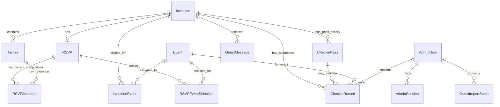

# Database Schema

This document describes the conceptual PostgreSQL schema. Do not create a Prisma schema in Phase 0 documentation.

## Modeling Decisions

### Attendance ownership

These concepts are separate and must not be treated as competing sources of truth:

- `InvitationEvent`: which events the household is allowed to attend.
- `RSVPEventSelection`: whether the household plans to attend one event and how many household attendees are expected at that event.
- `RSVPAttendee`: current attendee composition for the RSVP overall.
- `CheckinRecord`: actual confirmed household attendance for one event.

Event counts may differ from the RSVP attendee total. Example: RSVPAttendee total quantity is 4, Holy Matrimony expected count is 2, and Reception expected count is 4. This is valid.

MVP does not add an attendee-to-event join table. The product needs household event intent, expected total per event, total adult/child composition for the RSVP, and actual checked-in total per event. It does not currently require knowing exactly which named person attends which event.

### RSVP attendee model

The schema uses an `RSVPAttendee` table for current RSVP state, not history.

Allowed `attendee_type` values:

- `NAMED_INVITEE`
- `PLUS_ONE`
- `ADDITIONAL_CHILD`

Known spouse and known child are normal named Invitees. Dynamic attendees are not forced into permanent Invitee records.

### Public identifiers

Primary keys are PostgreSQL UUIDs. For MVP, API DTOs may expose UUID identifiers for non-secret resources that the client must reference. Sequential identifiers are not used. Credential hashes, credential versions, session hashes, password hashes, and admin-only fields are never public DTO fields.

### Import audit

`GuestImportBatch` records successful committed import provenance. Preview is not a committed batch. Failed-attempt persistence, if desired later, must occur outside the rolled-back domain transaction.

## ERD



## Entities

### AdminUser

Purpose: Stores OWNER login identity.

- Primary key: `id uuid`.
- Important fields:
  - `email citext or varchar`: unique login email.
  - `password_hash text`: Argon2id hash.
  - `role varchar`: MVP value `OWNER`; future extension path may allow `ADMIN`.
  - `status varchar`: `ACTIVE`, `DISABLED`.
  - `created_at timestamptz`.
  - `updated_at timestamptz`.
  - `last_login_at timestamptz null`.
- Constraints/indexes:
  - Unique `email`.
  - Check role in allowed values.
  - Check status in allowed values.
- Sensitive fields: `password_hash`.
- Deletion: not normally deleted; disable if needed.

Phase 8 Slice 8B0 additions (no schema change):

- `email` is stored **normalized**: trimmed and lowercased before persistence. It is `TEXT`, not `citext`; normalization is an application-boundary rule and every supported `AdminUser` writer must apply the same one. Maximum 254 characters, syntactically valid.
- `password_hash` holds the encoded **Argon2id** hash only (`memoryCost = 19456`, `timeCost = 2`, `parallelism = 1`, library-generated random salt). Plaintext passwords, reversible passwords, and password encryption keys are never persisted.
- `role` remains `OWNER`-only. No `ADMIN`/`EDITOR`/`VIEWER` value is added, and no role-management surface is introduced in Phase 8.
- `status` gates both login and session use. A `DISABLED` user gets `401 INVALID_CREDENTIALS` at login and `401 UNAUTHENTICATED` for an existing session.
- `last_login_at` is updated on every successful login.
- First-OWNER bootstrap is operator-only and refuses once **any** `AdminUser` row exists. The MVP supports one effective OWNER. **No singleton constraint is added**, because the schema may structurally permit multiple OWNER rows while the product provides no workflow to create them.

### AdminSession

Purpose: Server-managed opaque admin sessions.

- Primary key: `id uuid`.
- Foreign keys:
  - `admin_user_id uuid -> AdminUser.id`.
- Important fields:
  - `session_token_hash text`: unique hash of cookie token.
  - `csrf_token_hash text`: hash of CSRF token if persisted server-side.
  - `expires_at timestamptz`.
  - `revoked_at timestamptz null`.
  - `created_at timestamptz`.
  - `last_seen_at timestamptz null`.
  - `user_agent text null`.
  - `ip_address inet null`.
- Constraints/indexes:
  - Unique `session_token_hash`.
  - Index `admin_user_id`.
  - Index `expires_at`.
  - Active session lookup by `session_token_hash`.
- Sensitive fields: token hashes, IP address.
- Lifecycle: created at login, updated on use, revoked on logout or security action, expired by time.

Phase 8 Slice 8B0 additions (no schema change):

- `session_token_hash` stores `SHA-256(sessionToken)` of a 32-byte cryptographically secure random token encoded as unpadded Base64URL. The raw token is never persisted; it exists only transiently and inside the `HttpOnly` cookie.
- `csrf_token_hash` stores `SHA-256(csrfToken)`, where the CSRF token is `HMAC-SHA256(key = raw session token bytes, message = "admin-csrf-v1")` encoded as unpadded Base64URL. The raw CSRF token is never persisted; it can be re-derived at session bootstrap.
- `expires_at` is fixed at login to **12 hours** and is never extended by activity. There is no sliding expiration.
- Idle timeout is **30 minutes**, evaluated against `last_seen_at` when present, otherwise `created_at`. `last_seen_at` is written only when at least approximately 5 minutes have elapsed since the stored activity timestamp — not on every request.
- `revoked_at` is set on logout for the current session only. Multiple simultaneous sessions per `AdminUser` are allowed; login does not revoke other sessions and there is no "sign out everywhere" operation.
- A session is valid only when the `AdminUser` is `ACTIVE`, `revoked_at IS NULL`, `expires_at > now`, and the idle window has not elapsed.
- Session validity never depends on physical row deletion. Expired or revoked rows are immediately unusable while present; Phase 8B **may** opportunistically delete rows older than a recommended **7 days** past expiry or revocation, with no cron, scheduler dependency, or background worker added for it.
- `user_agent` and `ip_address` remain **`null`** in the MVP. Authentication does not rely on them; no proxy-trust configuration, fingerprinting, geolocation logic, or PII retention is introduced merely because the nullable columns exist. They are reserved for future operational/security telemetry.
- Login throttling is **in-process and ephemeral** and therefore adds **no** `failed_login_attempts` or `locked_until` column. See `TECHNICAL-ARCHITECTURE.md` (D7).

### Invitation

Purpose: Represents one household/group invitation.

- Primary key: `id uuid`.
- Important fields:
  - `display_name text`: household label.
  - `greeting_name text null`: name used in public greeting.
  - `public_token_version integer not null default 1`.
  - `public_token_hash text`: unique hash of current derived public invitation credential.
  - `status varchar`: `ACTIVE`, `ARCHIVED`.
  - `rsvp_deadline_at timestamptz null`: authoritative public RSVP cutoff instant. Phase 5 locks the public baseline value as `2026-12-25T16:59:59Z` (`25 December 2026, 23:59:59 Asia/Jakarta`).
  - `allow_plus_one boolean`.
  - `max_additional_children integer`.
  - `first_opened_at timestamptz null`.
  - `last_opened_at timestamptz null`.
  - `open_count integer not null default 0`.
  - `notes text null`: admin-only notes.
  - `created_at timestamptz`.
  - `updated_at timestamptz`.
  - `archived_at timestamptz null`.
- Constraints/indexes:
  - Unique `public_token_hash`.
  - Index `status`.
  - Check `public_token_version >= 1`.
  - Check `max_additional_children >= 0`.
  - Check `open_count >= 0`.
  - If `status = ARCHIVED`, `archived_at` should be set by application transaction.
- Sensitive fields: `public_token_hash`.
- Credential behavior:
  - Public credential is derived from server secret, invitation namespace, `id`, and `public_token_version`.
  - `id` is canonicalized to lowercase UUID form for derivation.
  - The current stored `public_token_hash` is the lowercase hexadecimal SHA-256 hash of the 43-character public credential string.
  - Regeneration increments `public_token_version`, stores new `public_token_hash`, and invalidates old credential immediately.
  - Plaintext public credentials are not stored.
- Deletion/archive:
  - Normal admin behavior is archive only.
  - Public access, RSVP, messages, QR validation, and check-in are denied while archived.
  - Exceptional destructive deletion is operational, not MVP product behavior.

### Invitee

Purpose: Named person known before RSVP.

- Primary key: `id uuid`.
- Foreign keys:
  - `invitation_id uuid -> Invitation.id`.
- Important fields:
  - `full_name text`.
  - `display_order integer`.
  - `category varchar`: `ADULT`, `CHILD`.
  - `label text null`: optional display/helper label such as primary guest, spouse, or family member.
  - `created_at timestamptz`.
  - `updated_at timestamptz`.
- Constraints/indexes:
  - Index `invitation_id`.
  - Unique `(invitation_id, display_order)`.
  - Check `display_order >= 0`.
  - Check category in `ADULT`, `CHILD`.
- Deletion: avoid deleting if referenced by current or historical RSVP/check-in context; prefer inactive/archive extension if needed later. Phase 8 locks the concrete rule: hard delete is permitted only when no `RSVPAttendee` row references the invitee, otherwise the request is rejected with `409 CONFLICT`. No inactive/archive column is added. See "Phase 8 Admin Management" below.

### Event

Purpose: Defines wedding events without hard-coded UI labels.

- Primary key: `id uuid`.
- Important fields:
  - `slug text`: e.g. `holy-matrimony`, `reception`.
  - `name text`.
  - `description text null`.
  - `starts_at timestamptz null`.
  - `ends_at timestamptz null`.
  - `venue_name text null`.
  - `address text null`.
  - `google_maps_url text null`.
  - `display_order integer`.
  - `is_active boolean`.
  - `created_at timestamptz`.
  - `updated_at timestamptz`.
- Constraints/indexes:
  - Unique `slug`.
  - Unique `display_order`.
  - Check `display_order >= 0`.
- Lifecycle: seeded/managed by OWNER in future if needed; MVP requires at least Holy Matrimony and Wedding Reception.

### InvitationEvent

Purpose: Authoritative invitation-event eligibility.

- Primary key: `id uuid`.
- Foreign keys:
  - `invitation_id uuid -> Invitation.id`.
  - `event_id uuid -> Event.id`.
- Important fields:
  - `created_at timestamptz`.
- Constraints/indexes:
  - Unique `(invitation_id, event_id)`.
  - Index `event_id`.
- Invariant: guests may RSVP only to events present in this table for their invitation.
- Mutation rule: changes that can affect existing RSVP/check-in state must follow the shared Invitation row lock order.

### RSVP

Purpose: Household RSVP lifecycle.

- Primary key: `id uuid`.
- Foreign keys:
  - `invitation_id uuid -> Invitation.id`.
  - `submitted_by_admin_user_id uuid null -> AdminUser.id`.
- Important fields:
  - `status varchar`: `PENDING`, `ACCEPTED`, `DECLINED`.
  - `version integer not null default 1`.
  - `dietary_notes text null`: household-level dietary information. Normalized on write: trimmed, maximum 500 characters after trimming, empty after trimming stored as `null`.
  - `guest_note text null`: optional RSVP note separate from GuestMessage. Not part of the Phase 5 public RSVP mutation contract.
  - `submitted_at timestamptz null`.
  - `last_updated_at timestamptz`.
  - `admin_override_reason text null`.
  - `created_at timestamptz`.
- Constraints/indexes:
  - Unique `invitation_id`.
  - Index `status`.
  - Check `version >= 1`.
- Lifecycle:
  - RSVP rows are created lazily by the first public mutation. No empty/`PENDING` RSVP row is pre-created at invitation creation time.
  - `PENDING` remains a valid stored status value, but the Phase 5 public flow never writes it: the first public mutation persists `ACCEPTED` or `DECLINED` directly.
  - Initial persisted version is `1`.
  - Every successful RSVP mutation increments `version` by one from the previous value.
  - Public mutation must provide `expectedVersion`.
  - `expectedVersion: null` means create-only: it succeeds only when no RSVP row exists. If a row exists once the Invitation lock is held and state is reloaded, return `409 RSVP_VERSION_CONFLICT`.
  - A non-null `expectedVersion` must equal the persisted `RSVP.version`; mismatch is `409 RSVP_VERSION_CONFLICT`.
  - Version checking happens after credential validation/hash, transaction start, Invitation row lock, and in-transaction RSVP reload.
  - Public/admin updates replace or reconcile current event selections and attendee rows in the same transaction.
  - `dietary_notes` is set to `null` whenever the RSVP transitions to `DECLINED`.
  - `guest_note` is not accepted, mutated, or cleared by Phase 5 public RSVP mutations.

### RSVPEventSelection

Purpose: Records event-specific attendance decision and expected count for an RSVP.

- Primary key: `id uuid`.
- Foreign keys:
  - `rsvp_id uuid -> RSVP.id`.
  - `event_id uuid -> Event.id`.
- Important fields:
  - `attending boolean`.
  - `expected_attendee_count integer`.
  - `created_at timestamptz`.
  - `updated_at timestamptz`.
- Constraints/indexes:
  - Unique `(rsvp_id, event_id)`.
  - Check `expected_attendee_count >= 0`.
- Application invariants:
  - `event_id` must be eligible through `InvitationEvent` for the RSVP invitation.
  - If `attending = false`, `expected_attendee_count = 0`.
  - If `attending = true`, `expected_attendee_count >= 1`.
  - If `attending = true`, `expected_attendee_count <= total quantity represented by RSVPAttendee`.
  - If RSVP status is `DECLINED`, all selections must have `attending = false` and count `0`; no attending/active selection may remain.
  - If RSVP status is `ACCEPTED`, at least one eligible selection must have `attending = true`. Accepted with zero attending events is rejected with `422 EVENT_NOT_SELECTED`.

### RSVPAttendee

Purpose: Current attendee composition for the RSVP overall.

- Primary key: `id uuid`.
- Foreign keys:
  - `rsvp_id uuid -> RSVP.id`.
  - `invitee_id uuid null -> Invitee.id`.
- Important fields:
  - `attendee_type varchar`: `NAMED_INVITEE`, `PLUS_ONE`, `ADDITIONAL_CHILD`.
  - `display_name text null`: optional for plus-one if later requested; not required for MVP count-only additional children.
  - `quantity integer`.
  - `created_at timestamptz`.
  - `updated_at timestamptz`.
- Constraints/indexes:
  - Index `rsvp_id`.
  - Index `invitee_id`.
  - Check `quantity > 0`.
  - Unique `(rsvp_id, invitee_id)` where `invitee_id is not null`.
  - Partial unique index for at most one `PLUS_ONE` row per RSVP where practical.
- Database constraints where practical:
  - `NAMED_INVITEE` requires `invitee_id is not null`.
  - `NAMED_INVITEE` requires `quantity = 1`.
  - `PLUS_ONE` requires `invitee_id is null`.
  - `PLUS_ONE` requires `quantity = 1`.
  - `ADDITIONAL_CHILD` requires `invitee_id is null`.
- Application transaction invariants:
  - Referenced Invitee must belong to the same Invitation as the RSVP.
  - `PLUS_ONE` allowed only when `Invitation.allow_plus_one = true`.
  - At most one `PLUS_ONE` attendee row per RSVP for MVP.
  - Total `ADDITIONAL_CHILD` quantity must not exceed `Invitation.max_additional_children`.
  - Known child Invitees do not consume `max_additional_children` unless a future product decision changes that rule.
  - Event expected counts must be less than or equal to total RSVPAttendee quantity.
  - When the RSVP transitions to `DECLINED`, no RSVPAttendee rows remain. Historical composition is not retained for MVP.
- Prisma note: partial unique indexes and multi-column conditional checks may require customized PostgreSQL migration SQL if Prisma declarative schema cannot express them.

### GuestMessage

Purpose: Guest wishes/messages associated with an active invitation.

- Primary key: `id uuid`.
- Foreign keys:
  - `invitation_id uuid -> Invitation.id`.
- Important fields:
  - `author_name text null`.
  - `message text`.
  - `created_at timestamptz`.
  - `is_hidden boolean`: admin moderation flag if needed.
- Constraints/indexes:
  - Index `invitation_id`.
  - Index `created_at`.
- Deletion: keep by default; hiding/moderation preferred over deletion.
- Archive rule: public submission denied when invitation is archived; existing messages remain visible to OWNER.

Phase 7 contract lock (Slice 7B0):

- **Cardinality: `Invitation 1 -> many GuestMessage`.** There is no unique constraint and no one-message-per-invitation rule. A second explicit submission creates a second row. This is expected behavior, not an accidental omission.
- **No schema change and no migration are required for Phase 7.** No idempotency column and no unique constraint are added, and no length `CHECK` constraint is required for the MVP: the 1000-character `message` cap and the 100-character `author_name` cap are enforced at the DTO/application boundary.
- `author_name` stays nullable; anonymous submission stores `null`. It is never derived from `Invitee`, `Invitation.greeting_name`, or `RSVP`.
- `message` stores the trimmed plain-text value. HTML and Markdown are never interpreted at persistence or render time.
- `is_hidden` remains an internal admin moderation property. Phase 7 public submission neither accepts nor returns it, and creates rows in the default internal state. Phase 8 Slice 8D0 locks admin moderation to `isHidden` only: set-to-value, idempotent, no delete, no reason, and **no attribution** — the model has no `updated_at`, `hidden_at`, or `hidden_by_admin_user_id`, and none is added. `is_hidden` has no public guest-facing effect because no public message wall exists.
- `GuestMessage` is separate from `RSVP.guest_note`. Phase 7 never writes, clears, mirrors, or synchronizes `RSVP.guest_note`.

### CheckinPass

Purpose: Household QR/check-in credential lifecycle.

- Primary key: `id uuid`.
- Foreign keys:
  - `invitation_id uuid -> Invitation.id`.
  - `rsvp_id uuid -> RSVP.id`.
- Important fields:
  - `token_hash text`: unique hash of current derived check-in credential.
  - `credential_version integer not null default 1`.
  - `status varchar`: `ACTIVE`, `REVOKED`, `EXPIRED`.
  - `issued_at timestamptz`.
  - `revoked_at timestamptz null`.
  - `revocation_reason text null`.
  - `expires_at timestamptz null`.
  - `created_at timestamptz`.
- Constraints/indexes:
  - Unique `token_hash`.
  - Index `invitation_id`.
  - Index `rsvp_id`.
  - Check `credential_version >= 1`.
  - Partial unique index: one active pass per invitation where `status = ACTIVE`.
- Sensitive fields: `token_hash`.
- Credential behavior:
  - Credential is derived from server secret, check-in namespace, `id`, and `credential_version`.
  - Plaintext credential/QR payload is not persisted.
- Lifecycle:
  - Issued when RSVP becomes accepted.
  - An accepted RSVP must have exactly one active household pass.
  - Retained on accepted-to-accepted detail updates; do not create a duplicate active pass.
  - Revoked when RSVP becomes declined.
  - Declined-to-accepted issues a new active pass; the previously revoked credential is never reactivated.
  - Revoked passes are immutable and never reactivated. Revoked rows remain historical/audit facts.
  - The pass lifecycle is applied in the same Invitation-scoped transaction as the RSVP mutation.
- Phase boundary:
  - Phase 5 owns only the minimal CheckinPass data lifecycle required to keep RSVP state transactionally consistent.
  - QR rendering, QR presentation/confirmation UX, QR scanning, and check-in mutation belong to later phases.

### CheckinRecord

Purpose: Successfully confirmed household attendance for one invitation and one event.

- Primary key: `id uuid`.
- Foreign keys:
  - `invitation_id uuid -> Invitation.id`.
  - `event_id uuid -> Event.id`.
  - `checkin_pass_id uuid null -> CheckinPass.id`.
  - `confirmed_by_admin_user_id uuid -> AdminUser.id`.
- Important fields:
  - `method varchar`: `QR`, `MANUAL`.
  - `attendee_count integer`.
  - `checked_in_at timestamptz`.
  - `created_at timestamptz`.
  - `note text null`.
- Constraints/indexes:
  - Unique `(invitation_id, event_id)`.
  - Index `event_id`.
  - Index `checkin_pass_id`.
  - Index `checked_in_at`.
  - Check `attendee_count >= 1`.
  - If `method = QR`, `checkin_pass_id` must be non-null where practical.
  - If `method = MANUAL`, `checkin_pass_id` may be null.
- Application invariants:
  - Confirmation requires active invitation, accepted RSVP, eligible event, and selected event attendance.
  - QR confirmation additionally requires active CheckinPass.
  - `attendee_count <= RSVPEventSelection.expected_attendee_count` for MVP.
  - Duplicate confirmation for the same invitation/event returns deterministic conflict.
- Non-goal: invalid, revoked, duplicate, or rejected scan attempts are not persisted as CheckinRecord rows in MVP.

### GuestImportBatch

Purpose: Audit successful committed guest imports.

- Primary key: `id uuid`.
- Foreign keys:
  - `committed_by_admin_user_id uuid -> AdminUser.id`.
- Important fields:
  - `source_filename text`.
  - `source_format varchar`: `CSV`, `XLSX`.
  - `status varchar`: `COMMITTED`.
  - `row_count integer`.
  - `created_invitation_count integer`.
  - `created_invitee_count integer`.
  - `warning_count integer`.
  - `error_count integer`.
  - `summary jsonb`.
  - `committed_at timestamptz`.
- Constraints/indexes:
  - Check counts are non-negative.
  - Index `committed_at`.
- Lifecycle:
  - Created only as part of a successful import commit.
  - Preview is not a GuestImportBatch.
  - Failed-attempt persistence, if desired later, must be outside the rolled-back domain transaction.

## Key Invariants and Enforcement

| Invariant | Enforcement |
|---|---|
| Invitation token hash is unique | Database unique constraint |
| Invitation credential version is positive | Database check |
| Check-in token hash is unique | Database unique constraint |
| CheckinPass credential version is positive | Database check |
| Admin session token hash is unique | Database unique constraint |
| One active check-in pass per invitation | Partial unique index plus transaction |
| Revoked pass cannot become active again | Application service rule |
| Only accepted RSVP can have active pass | RSVP transaction/application rule |
| Accepted RSVP has exactly one active pass | Partial unique index plus RSVP transaction/application rule |
| Accepted RSVP selects at least one eligible attending event | API/application transaction validation |
| Declined RSVP cannot leave active pass | RSVP transaction/application rule |
| Declined RSVP leaves no attendee rows and null dietary notes | RSVP transaction/application rule |
| Public RSVP create and update are rejected after the cutoff instant | API/application validation against `Invitation.rsvp_deadline_at` |
| RSVP version increments on every mutation | RSVP transaction/application rule |
| Stale RSVP expectedVersion is rejected | RSVP transaction/application rule |
| RSVP event must be eligible | Application transaction validation against InvitationEvent |
| If event attending is false, expected count is 0 | API/application validation |
| If event attending is true, expected count is 1..RSVPAttendee total | API/application validation |
| RSVPAttendee quantity is positive | Database check |
| Named invitee row references an Invitee and quantity is 1 | Database check where practical plus application validation |
| Referenced Invitee belongs to same Invitation | Application transaction validation |
| Plus-one requires null invitee and quantity 1 | Database check where practical |
| Plus-one permission | Application transaction validation |
| Additional child requires null invitee and positive quantity | Database check where practical |
| Additional child allowance | Application transaction validation |
| Duplicate named invitee in same RSVP is prevented | Partial unique index |
| At most one PLUS_ONE row per RSVP | Partial unique index where practical plus application validation |
| Duplicate confirmed check-in cannot create two attendance records | Unique `(invitation_id, event_id)` plus transaction |
| CheckinRecord attendee_count is at least 1 | Database check |
| CheckinRecord attendee_count does not exceed expected event count | Application transaction validation |
| Archived invitation denies public access, RSVP, messages, QR validation, and check-in | API/application validation |
| Archived invitation historical data remains intact | Product rule plus FK/delete policy |

Cross-table business rules require transactional application logic. Do not claim PostgreSQL check constraints can enforce event eligibility, RSVP/pass consistency, or companion permissions alone.

## Transaction Boundaries

### Shared lock order

Every invitation-scoped state-changing operation that can conflict must:

1. Begin transaction.
2. Select the target `Invitation` row `FOR UPDATE`.
3. Reload and revalidate dependent current state.
4. Apply the domain transition.
5. Commit.

Use this for public RSVP mutation, OWNER RSVP override, event eligibility changes that can affect RSVP/check-in, check-in confirmation, invitation archive, and credential regeneration/rotation.

Guest message insertion (Phase 7) is **not** in that list and needs no row lock or version: messages are create-only appends that never update shared invitation state. Its requirement is narrower but still atomic — the ACTIVE-invitation check and the `GuestMessage` insert must occur in one transaction so a message is never intentionally written into an archived invitation. The owning `invitation_id` comes from credential resolution and never from the request body.

### Public invitation retrieval and open tracking

This section documents transactional behavior only. It does not alter the database schema and requires no migration.

Valid public invitation retrieval is not a pure read because it mutates:

- `first_opened_at`
- `last_opened_at`
- `open_count`

The operation follows the Invitation-first lock discipline:

1. Validate and hash the inbound public credential outside the database transaction.
2. Start a Prisma interactive transaction.
3. Lock the matching Invitation row with a narrow parameterized query equivalent to:

   ```sql
   SELECT id, status
   FROM invitations
   WHERE public_token_hash = $1
   FOR UPDATE;
   ```

4. If no row exists, return generic `INVITATION_NOT_AVAILABLE`.
5. If status is not `ACTIVE`, return the same generic unavailable response.
6. Update aggregates atomically with a parameterized statement equivalent to:

   ```sql
   UPDATE invitations
   SET
     first_opened_at = COALESCE(first_opened_at, CURRENT_TIMESTAMP),
     last_opened_at = CURRENT_TIMESTAMP,
     open_count = open_count + 1,
     updated_at = CURRENT_TIMESTAMP
   WHERE id = $1::uuid
     AND status = 'ACTIVE'
   RETURNING
     first_opened_at,
     last_opened_at,
     open_count;
   ```

7. Exactly one row must be updated.
8. Within the same transaction, read the public projection: Invitation public fields, eligible InvitationEvent/Event rows, Invitees, and optional RSVP.
9. Commit and map the already-read data to the public DTO.

Concurrency requirements:

- `open_count` increments atomically; concurrent loads must not lose increments.
- `first_opened_at` is assigned once via `COALESCE`.
- `last_opened_at` updates on every valid load.
- All public projection reads happen in the same transaction as the open update.
- PostgreSQL `READ COMMITTED` is sufficient when all conflicting invitation-scoped writers follow Invitation-first locking.

Archive/public-open race behavior:

- If public retrieval gets the Invitation lock first, it validates `ACTIVE`, records one open, reads and returns the active projection, and archive waits.
- If archive commits first, later public retrieval sees `ARCHIVED`, records no open, and returns `INVITATION_NOT_AVAILABLE`.

Open aggregates are persisted reporting data, not best-effort telemetry. If the aggregate update or projection read fails, the transaction rolls back and the request fails.

### RSVP update

Required mutation order:

1. Validate public credential shape.
2. Derive/hash the credential outside the transaction.
3. Begin the Prisma interactive transaction.
4. Lock the Invitation using the established parameterized `SELECT ... FOR UPDATE` pattern.
5. Require Invitation status `ACTIVE`.
6. Evaluate the RSVP cutoff against `Invitation.rsvp_deadline_at`.
7. Reload current RSVP and related mutation state under the lock.
8. Check `expectedVersion`.
9. Validate status, event eligibility, attendees, counts, and dietary data.
10. Apply RSVP, RSVPEventSelection, and RSVPAttendee changes.
11. Apply the minimal CheckinPass lifecycle invariant.
12. Increment/set `RSVP.version`.
13. Commit only when final state is internally consistent.

Any domain error rolls the transaction back. The raw public credential must never be persisted or retained in logs.

Historical attendee composition before the edit does not need to be retained for MVP. Old revoked CheckinPass rows and confirmed CheckinRecord rows remain historical facts.

### Check-in validation

QR validation is read-only. It resolves credential hash and validates current state but does not lock as a reservation and does not create CheckinRecord.

### Check-in confirmation

One transaction must:

1. Lock Invitation row `FOR UPDATE`.
2. Load current RSVP/event/pass state.
3. Revalidate active invitation, accepted RSVP, event eligibility, selected event attendance, active pass when QR is used, and attendee count.
4. Check existing CheckinRecord for `(invitation_id, event_id)`.
5. Insert CheckinRecord.
6. Commit.

Concurrent confirmations are guarded finally by unique `(invitation_id, event_id)`.

### Guest import commit

MVP commit is all-or-nothing for selected valid rows. The transaction creates invitations, invitees, invitation events, default RSVP state where used, invitation credential version/hash initialization, and successful import batch provenance. If any selected row fails commit, rollback the full selected import.

## Phase 8 Admin Management

Contract lock (Slice 8D0) — persistence consequences only. API semantics live in `API-CONTRACT.md`.

**No schema change and no migration are required for Phase 8 admin management.** Every admin-management read and mutation is expressed against the existing models.

Schema capability per admin area:

| Admin area | Schema support | Concurrency mechanism | Attribution |
| --- | --- | --- | --- |
| Dashboard | Existing `Invitation`, `RSVP`, `RSVPEventSelection`, `Event` rows | Consistent read | None needed |
| Invitation list/detail | `Invitation`, `Invitee`, `InvitationEvent`, `RSVP`, `GuestMessage`, `CheckinPass` | n/a | None |
| Invitation create | `Invitation`, `InvitationEvent`, `Invitee` | Single transaction | None |
| Invitation update | `Invitation.updated_at` | `expectedUpdatedAt` compare under the Invitation row lock | None |
| Archive | `Invitation.status`, `Invitation.archived_at` | Invitation row lock; idempotent | None |
| Public URL / regeneration | `Invitation.public_token_version`, `Invitation.public_token_hash` | Invitation row lock plus `expectedTokenVersion` compare | None |
| Invitee create/update/delete | `Invitee`, `RSVPAttendee.invitee_id` FK `Restrict` | Invitation row lock for create; `expectedUpdatedAt` for update | None |
| Eligibility replacement | `InvitationEvent`, `RSVPEventSelection` | Invitation row lock; reject if a selection references a removed event | None |
| RSVP debug/override | `RSVP.version`, `RSVP.submitted_by_admin_user_id`, `RSVP.admin_override_reason` | Invitation row lock plus `expectedVersion` compare | **Yes** — both columns are written |
| Guest message moderation | `GuestMessage.is_hidden` | None needed; set-to-value | **No** |

Known schema limitations, accepted for the MVP rather than fixed:

- **`Invitation` has no `version` column.** Invitation and Invitee update concurrency uses `expectedUpdatedAt` instead of an integer version. `RSVP` keeps its `version`.
- **`Invitee` has no soft-delete or active state.** Deletion is hard delete and is blocked while an `RSVPAttendee` references the invitee.
- **`GuestMessage` has no moderation actor or timestamp.** Hide/unhide is unattributed. `is_hidden` exists; `updated_at`, `hidden_at`, and `hidden_by_admin_user_id` do not.
- **No generic admin audit-log table exists**, and Phase 8 does not add one. Actor attribution is available only where the schema already carries it: `RSVP.submitted_by_admin_user_id` (written by the OWNER override), `CheckinRecord.confirmed_by_admin_user_id` and `GuestImportBatch.committed_by_admin_user_id` (later phases).
- **`RSVP.admin_override_reason` and `RSVP.guest_note` had no writer before Phase 8.** The OWNER RSVP override becomes the first writer of `admin_override_reason`. `guest_note` stays unwritten in Phase 8.
- **Token regeneration needs no idempotency column.** Derivation is deterministic from `CREDENTIAL_SECRET`, `Invitation.id`, and `public_token_version`, so the current link is always re-derivable and a lost response needs no stored key.

Archive persistence rules:

- Archive sets `status = ARCHIVED` and `archived_at` in one transaction and preserves every child and history row. Existing FKs from `Invitee`, `RSVP`, `InvitationEvent`, `CheckinPass`, and `GuestMessage` are `Restrict`, so nothing cascades.
- The public credential is not rotated on archive. The row simply stops resolving, because public lookup requires `ACTIVE`.
- Admin mutations against an archived invitation are rejected with `409 CONFLICT`. Read-only historical access remains available.
- There is no unarchive operation. Nothing in the schema prevents one; the contract simply does not define one.

## Query Patterns

- Public invitation lookup by public credential hash.
- Open aggregate update by Invitation row on valid active public load.
- Admin invitation list filtered by status, RSVP status, event eligibility, and search.
- RSVP detail by invitation.
- Active pass lookup by check-in credential hash.
- Confirmed check-in history by event and invitation.
- Dashboard counts by invitation status, RSVP status, and expected attendee counts. The Phase 8 dashboard excludes archived invitations from every RSVP and headcount metric and carries **no** check-in metric; `CheckinRecord` counts belong to Phase 10 and Phase 11 reporting.
- CSV export queries for invitations, RSVP, dietary notes, and check-in.

## Migration Principles

- Migrations must be reviewed with the Database Schema document.
- Avoid destructive migrations without explicit data preservation plan.
- Add nullable columns before backfilling where needed.
- Protect credential hash uniqueness before production credential generation.
- Use custom PostgreSQL migration SQL for partial indexes/conditional constraints that Prisma cannot express declaratively.
- Preserve archived invitation history.
