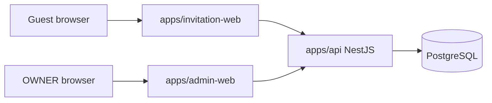

# Technical Architecture

## System Context



Frontends never access PostgreSQL directly. The backend API owns authentication, authorization, domain validation, persistence, credential derivation, QR/pass lifecycle, import, check-in, and reporting.

## Monorepo Layout

Planned layout:

```text
apps/
  invitation-web/
  admin-web/
  api/
packages/
  api-client/
  shared-types/
  eslint-config/
  tsconfig/
docs/
```

Do not create this structure until Phase 1 after final Phase 0 documentation lock.

## Application Responsibilities

### invitation-web

- Render the Figma-derived public invitation.
- Manage envelope/opened/long-page flow.
- Call public invitation APIs.
- Provide UX validation and loading/error states.
- Submit RSVP with `expectedVersion`.
- Display RSVP confirmation and backend-derived active QR payload.

Phase 4 read-only frontend contract:

- Public route: `/i/[publicCredential]`.
- The route credential is case-sensitive and must not be normalized, stored in
  browser storage, sent to analytics, copied into visible error UI, or logged by
  custom frontend code.
- Retrieval is server-side by default: the route receives the credential, uses
  the generated `packages/api-client`, calls
  `GET /api/public/invitations/{publicCredential}`, and passes the
  `PublicInvitationResponse` to presentation components.
- Use the server-only environment variable `INVITATION_API_BASE_URL` for the API
  origin/base URL. It must not be prefixed with `NEXT_PUBLIC_` and must not
  contain credentials. Local development value is conceptually
  `http://localhost:4000`.
- Client components are limited to local visual state such as envelope/opened
  transitions, reveal behavior, and reduced-motion handling. Avoid duplicate
  client-side invitation fetching and do not introduce TanStack Query for Phase 4
  unless a later technical review documents a need.
- Public invitation event timestamps remain backend-owned ISO date-time values.
  `invitation-web` owns guest-facing venue-local presentation for event cards:
  render `startsAt` in `Asia/Jakarta` using `HH.mm` 24-hour format without
  relying on process, server, browser, or workstation local timezone settings.
- Phase 4 maps `INVITATION_NOT_AVAILABLE` to one generic unavailable UI and does
  not infer whether a credential was malformed, unknown, stale, or archived.
- Phase 4 does not implement RSVP submission, QR confirmation, or guest message
  submission.

### admin-web

- Provide OWNER login, session bootstrap, and the authenticated shell.
- Manage invitations, invitees, event eligibility, imports, RSVP, messages, check-in, and reports.
- Use generated API client.
- Never embed database logic.

Phase 8 auth foundation for admin-web (locked in Slice 8B0):

- Declare `@wedding-invitation/api-client` as a proper workspace dependency. Do **not** introduce new relative-source imports of the form `../../packages/api-client/src/**`.
- Browser-facing admin requests use the same-origin `/api` surface. Server-side admin-web requests may use an internal API base URL but must explicitly forward **only** the required session cookie. Do not forward arbitrary browser headers.
- Protected layouts bootstrap the session server-side via `GET /api/admin/auth/me`. No Next `middleware.ts` is required for the MVP.
- Route protection is UX and defense in depth; the backend remains the authoritative security boundary.

Phase 8 management surface (locked in Slice 8D0):

- Protected routes: `/` (dashboard), `/invitations`, `/invitations/new`, `/invitations/[invitationId]`, `/invitations/[invitationId]/edit`, `/rsvps`, `/rsvps/[rsvpId]`, `/messages`.
- There is no top-level `/invitees`, `/events`, `/checkin`, `/imports`, or `/reports` route in Phase 8. Invitees and eligibility are managed from the invitation detail route, and invitation-scoped messages are read through the scoped API rather than a separate route.
- Shell navigation exposes Dashboard, Invitations, RSVPs, and Messages, alongside OWNER identity and sign-out. Imports, check-in, and reports are not rendered as disabled or placeholder navigation, because those phases do not exist yet.
- Unsafe admin mutations never auto-retry. Create, invitee create, archive, and token regeneration each require explicit operator action, and an uncertain outcome is resolved by re-reading state rather than by resending the request.
- Destructive actions require explicit confirmation: archive, token regeneration, and invitee deletion. The regeneration confirmation must state that previously distributed links stop working immediately and that the action cannot be undone.
- Raw `qrPayload` is never fetched, rendered, or stored by the Phase 8 admin UI.

### api

- Expose public and admin HTTP APIs.
- Enforce all business rules.
- Manage opaque admin sessions.
- Derive public invitation and check-in credentials without storing plaintext bearer values.
- Own OpenAPI contract generation.
- Use PostgreSQL through Prisma.

## Backend Modular Monolith

Expected modules:

- `auth`: OWNER login/logout, sessions, password verification, CSRF/origin checks.
- `admin-users`: OWNER account persistence and password lifecycle.
- `invitations`: invitation lifecycle, credential regeneration, public access, open aggregates.
- `invitees`: named invitee management.
- `events`: event definitions and ordering.
- `rsvp`: household RSVP, event selections, current attendee composition, dietary notes, versioning, pass lifecycle coordination.
- `messages`: public guest message submission and persistence (Phase 7), plus Phase 8 admin listing, scoped listing, and `isHidden` moderation.
- `checkin`: pass credential derivation, QR validation, duplicate-safe CheckinRecord confirmation. Phase 10.
- `imports`: CSV/XLSX parse, validate, preview, commit. Phase 9.
- `reports`: Phase 11 reporting metrics and CSV export. It does **not** own the Phase 8 dashboard, which is a narrower operational read.
- `admin`: Phase 8 admin-management read and orchestration surface — the dashboard read, and the admin-facing list/detail projections that aggregate invitation, invitee, eligibility, RSVP, and message state. Admin invitation/invitee/eligibility mutations live with their owning feature modules and are reached through this surface.
- `database`: Prisma integration and transaction helpers.
- `security`: HMAC credential derivation, hashing, session token generation, and redaction helpers.
- `health`: health/readiness endpoints.
- `common`: shared errors, pagination, sorting/search normalization, request context, and the shared admin enforcement surface.

Module dependency rule: feature modules may depend on `common`, `database`, and `security`; cross-feature writes should go through application services, not direct table manipulation from unrelated modules.

`common` also hosts the shared admin enforcement surface locked in Phase 8 Slice 8D0. It is the one place that decides whether an `/api/admin/**` route requires a session, OWNER authorization, CSRF, and origin validation, and it recognizes method safety automatically. Feature modules do not restate those rules. See "Admin Management Architecture".

## API Contract and Client Generation

- OpenAPI generated by the NestJS backend is the API contract source.
- `packages/api-client` should be generated from OpenAPI.
- Frontends consume the generated client rather than duplicating TypeScript interfaces.
- Breaking API changes require updating `API-CONTRACT.md`, regenerating the client, and updating dependent frontend code in the same task.

## Public Resource Identifiers

PostgreSQL primary keys are UUIDs. For MVP, API DTOs may expose UUID identifiers for non-secret resources that the client must reference, such as events, invitees, invitations in admin APIs, RSVP records, and check-in records. These UUIDs are random, non-sequential identifiers. The API must never expose credential hashes, credential versions, password/session data, internal audit-only fields, or admin-only notes in public responses.

## Admin Authentication Architecture

**Locked by Phase 8 Slice 8B0.** This section is the authoritative admin-auth contract. It resolves the previously open topology, cookie, bootstrap, password, session, CSRF, error, enumeration, throttling, and route-protection questions. Do not re-litigate these decisions during Phase 8 implementation.

MVP uses opaque server-managed sessions, not JWT access/refresh tokens.

Rationale:

- Personal/internal OWNER-only admin.
- Simpler revocation and expiry.
- Avoids unnecessary token refresh complexity.
- Compatible with Next.js admin frontend and NestJS API on Docker/VPS.

### Deployment topology (D1)

The administration surface is **same-origin in the browser**. The browser sees one admin origin serving both the admin UI and the admin API:

```
https://<admin-host>/          admin-web
https://<admin-host>/api/**    API (proxied)
```

- **No cross-origin credentialed CORS for the MVP.** Do not enable broad CORS, do not use `Access-Control-Allow-Origin: *`, do not require browser `credentials: "include"` across origins.
- Nest may run internally on another port or container. That is an implementation detail hidden behind a reverse proxy, gateway, or development proxy. The browser still sees one origin.
- The public invitation site may live on a different origin. Admin and public share no cookie scope.
- The admin session cookie is **host-only** to the dedicated admin origin and is never scoped to a shared parent domain.
- Development: `admin-web` stays on port 3001 and Nest stays on port 4000. `admin-web` may proxy `/api/**` to the local Nest API so the browser remains same-origin from its own perspective. The concrete development proxy belongs to Slice 8C.

### Cookie contract (D1)

Production:

| Attribute | Value |
| --- | --- |
| Name | `__Host-admin_session` |
| `HttpOnly` | `true` |
| `Secure` | `true` |
| `SameSite` | `Strict` |
| `Path` | `/` |
| `Domain` | **omitted** |

- The cookie lifetime matches the session absolute expiration.
- No `Domain` attribute is ever set. The `__Host-` prefix requires `Secure`, `Path=/`, and no `Domain`.
- Production admin authentication requires HTTPS.

Development / isolated test runtime only: name `admin_session`, `HttpOnly=true`, `Secure=false`, `SameSite=Strict`, `Path=/`, `Domain` omitted. **Production must refuse to issue the insecure development cookie configuration.**

### First OWNER bootstrap (D2 / D12)

First OWNER creation is **operator-only** and is not reachable over the network.

- There is **no** `/setup`, `/register`, or `/bootstrap` HTTP route, and no public admin registration.
- Phase 8B provides an operator CLI, conceptually `pnpm --filter api admin:bootstrap-owner`. Exact script spelling may follow repository conventions.
- Input comes from runtime environment variables `ADMIN_BOOTSTRAP_EMAIL` and `ADMIN_BOOTSTRAP_PASSWORD`. These values must never be committed, written to files by the command, logged, included in exception text, or persisted in plaintext.
- The CLI validates the credentials, normalizes the email, hashes the password with the locked Argon2id parameters, enters an atomic database bootstrap critical section, verifies `admin_users` is empty, creates exactly one `ACTIVE` OWNER, and exits.
- If **any** `AdminUser` already exists, bootstrap refuses. It must not update the existing account, reset its password, create a second OWNER, or silently succeed as though it created something.
- No default OWNER email, no default password, no hard-coded credentials.

The empty-table check and OWNER creation must be **concurrency-safe**. Two simultaneous bootstrap commands must produce exactly one successful OWNER creation and one safe refusal. Use the smallest PostgreSQL transaction-scoped serialization mechanism compatible with the current architecture — a transaction advisory lock or equivalent. A bare `SELECT count(*)` followed by `INSERT` without serialization is not sufficient. No new column and no migration are required.

### OWNER count doctrine (D12)

The supported MVP deployment has **one effective OWNER**. The schema may structurally permit multiple OWNER rows, but Phase 8 provides no product workflow for creating additional OWNERs and the first-owner CLI refuses once any `AdminUser` exists. Phase 8 adds no admin-user creation UI, no role management, no additional-OWNER creation, and no `ADMIN`/`EDITOR`/`VIEWER` roles.

Do not add a database singleton constraint. Do not add a role-management surface.

### Login identity (D3)

The admin login identifier is `email`. Normalization before bootstrap persistence **and** before login lookup: trim outer whitespace, then lowercase. Maximum 254 characters and syntactically valid. All supported `AdminUser` writers must use the same normalization.

No username login, no SSO, no OAuth/OIDC, no magic link, no Microsoft login.

### Password policy and hashing (D3)

Policy, locked for the MVP without MFA:

- Minimum **15** Unicode code points, maximum **128** Unicode code points.
- The password is **not trimmed**; whitespace is valid password content.
- Unicode is allowed. No mandatory uppercase, lowercase, digit, or symbol rule. No silent truncation.
- The bootstrap password obeys the same policy used by authentication.

Hashing:

- Algorithm: **Argon2id**.
- Dependency for 8B: **`@node-rs/argon2`**. Do not use `bcrypt`, `bcryptjs`, SHA-256, HMAC, or PBKDF2 for password storage.
- Parameters: `memoryCost = 19456` KiB, `timeCost = 2`, `parallelism = 1`.
- Use a library-generated cryptographically random salt.
- Persist only the encoded Argon2id hash in `AdminUser.passwordHash`.
- Never persist a plaintext password, a reversible password, or a password encryption key. No pepper is required for the MVP.
- Never log `password` or `passwordHash`.

Phase 8 does not add a password strength library, breached-password lookup, email password reset, password-change UI, or MFA.

### Session token (D4)

- Opaque random tokens. **Not JWT.**
- Each login session uses **32 cryptographically secure random bytes** generated with Node cryptographic randomness, encoded as unpadded Base64URL (conceptually 43 characters).
- Never accept a session identifier supplied by the login request. Every successful login creates a **new** token.
- Persist only `SHA-256(sessionToken)` in `AdminSession.sessionTokenHash`.
- The raw session token exists only transiently during login/session processing and inside the HttpOnly browser cookie. It must not be persisted, returned in JSON, logged, placed in a URL, or placed in `localStorage`/`sessionStorage`.

### Session lifetime and activity (D4)

- Absolute lifetime: **12 hours** from successful login. `expiresAt` is fixed at login and is never extended by activity.
- Idle timeout: **30 minutes**.
- A session is valid only when **all** are true: `AdminUser.status === ACTIVE`; `AdminSession.revokedAt IS NULL`; `AdminSession.expiresAt > now`; and idle duration since the effective last activity is at most 30 minutes.
- Effective last activity is `lastSeenAt` when present, otherwise `createdAt`.
- Do **not** write `lastSeenAt` on every request. Update it when at least approximately 5 minutes have elapsed since the stored activity timestamp. This never extends `expiresAt`.

### Session rotation and concurrency (D4 / D10)

- No mid-session token rotation in the MVP. A fresh token is issued on every successful login.
- Login never adopts or reuses a client-provided session identifier.
- Logout revokes the current session. Expired sessions are never reactivated.
- **Multiple simultaneous sessions per OWNER are allowed.** Successful login does not revoke other valid sessions. There is no one-session-per-OWNER constraint, no revoke-other-sessions-on-login, and no "sign out everywhere" operation in the Phase 8 auth foundation.

### Expired-session cleanup and telemetry (D4)

- Session validity does not depend on physical row deletion. Expired or revoked rows are immediately unusable even while present.
- Phase 8B **may** perform bounded opportunistic cleanup of old session rows, with a recommended retention of 7 days for expired/revoked rows. Do not create cron infrastructure, a scheduler dependency, or a background worker solely for this.
- `AdminSession.userAgent` and `AdminSession.ipAddress` remain `null` in the MVP. Authentication does not rely on them. Do not introduce proxy-trust configuration, fingerprinting, geolocation logic, or PII retention merely because the nullable columns exist. They are reserved for future operational/security telemetry.

### CSRF model (D5)

All authenticated unsafe admin operations require the `X-CSRF-Token` header. Unsafe methods are `POST`, `PUT`, `PATCH`, `DELETE`, with exactly one exception: `POST /api/admin/auth/login` has no authenticated session yet. `GET`/`HEAD`/`OPTIONS` must not mutate state and do not require a CSRF token. Logout remains CSRF-protected.

One deterministic CSRF token is bound to each `AdminSession`:

- After generating the raw 32-byte session token, derive the CSRF token with **HMAC-SHA256** keyed by the **raw session token bytes** and the context string `admin-csrf-v1`.
- Encode the HMAC result as unpadded Base64URL.
- Persist `SHA-256(csrfToken)` in `AdminSession.csrfTokenHash`. Never persist the raw CSRF token.
- Because the token is deterministically bound to the raw session token, the API can re-derive it during authenticated session bootstrap without storing the raw token.
- Use timing-safe comparison.

Do not use a double-submit cookie, a CSRF token in a URL, or a CSRF token in `localStorage`/`sessionStorage`.

Issuance and recovery: a successful login returns the raw CSRF token in JSON, and `GET /api/admin/auth/me` returns the same per-session token. This recovers after page refresh, a new admin-web server render, or loss of in-memory frontend state without rotating the session or the CSRF token. The token lasts only for the lifetime of that `AdminSession`; a new login produces a different token.

### Origin protection (D5)

Defense in depth: all browser unsafe admin operations must also pass exact admin-origin validation against the configured `ADMIN_ORIGIN` (a full expected origin: scheme + host + optional port; no wildcard, no trailing path).

- If `Origin` is present, require an **exact** match with `ADMIN_ORIGIN`.
- If `Origin` is absent but `Referer` is present, require its origin to exactly match `ADMIN_ORIGIN`.
- If neither yields a valid expected origin, reject the unsafe request.
- Do not use substring or suffix matching.
- `POST /api/admin/auth/login` has no CSRF token yet and **must still enforce** the expected-origin rule.
- Do not enable broad CORS to solve this.

### Session-bound CSRF and cookie rationale

- The session cookie is `HttpOnly`, so script cannot read it.
- The production cookie is `Secure`, so it is never sent over plaintext transport.
- The cookie is host-only, so sibling subdomains cannot receive it.
- `SameSite=Strict` is defense in depth, **not** a CSRF solution on its own.
- Unsafe admin requests still require an explicit CSRF token bound to the session.
- Unsafe browser requests additionally require exact `Origin`/`Referer` validation.
- The backend remains the authoritative security boundary.

### Authorization doctrine (D9)

- The **backend** is the authoritative security boundary. Admin-web route protection is UX and defense in depth.
- Every `/api/admin/**` operation except login independently enforces a valid session, and where required OWNER authorization, and for unsafe methods CSRF plus origin validation.
- Never trust client route state, hidden UI, a Next layout, or browser-side role data as authorization.
- Phase 8B provides a narrow reusable auth foundation conceptually covering session resolution, current `AdminUser` resolution, `ACTIVE`-status enforcement, OWNER authorization, CSRF enforcement, origin enforcement, and a typed current-admin request context. Exact class and decorator names are not locked here.

### admin-web route protection (D9)

Use **server-side session bootstrap** for protected admin layouts and routes; do not use client-side-only auth protection. **No Next `middleware.ts` is required for the MVP.** Conceptually `/login` is public and the dashboard and management routes are protected. The protected server layout checks `GET /api/admin/auth/me` before rendering authenticated content and redirects unauthenticated visitors to `/login`. Backend authorization remains authoritative even if the frontend redirect is bypassed.

### Session expiry UX (D11)

When `/me` or another protected admin API call returns `401 UNAUTHENTICATED`, admin-web returns the user to `/login` with one concise generic state: "Your admin session has ended. Please sign in again." Do not distinguish expired, revoked, disabled, or missing in frontend copy. Do not persist sensitive form drafts to browser storage merely to survive session expiry. After successful login, navigate to the admin dashboard. No re-auth modal in the MVP.

### Logout (D13)

`POST /api/admin/auth/logout` revokes the **current session only**: it sets `revokedAt` on the current `AdminSession`, clears the current session cookie using the same name/path/environment configuration that was used at login, and returns `204`. It does not revoke other OWNER sessions. A future "logout everywhere" capability is outside the Phase 8 auth foundation.

### Disabled accounts

`AdminUser.status` must be `ACTIVE` for both login and session use. A `DISABLED` user gets `401 INVALID_CREDENTIALS` at login and `401 UNAUTHENTICATED` for an existing session. Phase 8's auth foundation implements no account-disable UI or endpoint. If an account becomes `DISABLED` through future trusted administration, existing sessions immediately cease to be usable because session resolution checks the current `AdminUser` status.

### Login throttling (D7)

The API implements a small **in-process** login limiter. No Redis, no database attempt counter, no lockout column, no CAPTCHA, and no new rate-limit infrastructure for the MVP.

- Per normalized email: 10 failed attempts per 15 minutes.
- Process-wide: 100 failed attempts per 15 minutes.
- Unknown emails participate in the same per-email limiter.
- On threshold: `429 TOO_MANY_LOGIN_ATTEMPTS`, without indicating whether the account exists.
- A successful login clears the normalized-email failure bucket.
- Limiter state is intentionally ephemeral, resets when the API process restarts, and is not an account status stored in `AdminUser`.

This is acceptable **only** for the MVP's single-API-instance deployment. Before horizontal or multi-instance scaling, move login throttling to a shared edge or store mechanism. This deployment constraint is recorded in `DEPLOYMENT-SECURITY.md`.

### Login flow

1. OWNER submits email and password to `POST /api/admin/auth/login`.
2. API normalizes the email, applies the origin rule, and checks the in-process limiter.
3. API verifies the password against the Argon2id hash in `AdminUser.passwordHash`.
4. API generates a new 32-byte random session token and derives the session-bound CSRF token.
5. API stores only `sessionTokenHash` and `csrfTokenHash` in `AdminSession`, with `expiresAt` fixed at login.
6. API sets the environment-appropriate `HttpOnly` session cookie and updates `AdminUser.lastLoginAt`.
7. API returns the user identity, session expiry, and the raw CSRF token. The raw session token is never in the response body.
8. Admin frontend sends `X-CSRF-Token` for unsafe methods.
9. API authenticates by hashing the cookie token and finding a valid session, then enforces OWNER authorization and, for unsafe methods, CSRF plus origin.
10. Logout revokes the current session and clears the cookie.

## Credential Architecture

Public invitation and check-in credentials are deterministic server-derived bearer credentials.

The Phase 3 public invitation credential format is a stable compatibility contract. Changing the canonical input format, output encoding, or lookup hash after credentials have been issued requires an explicit compatibility or migration decision.

### Credential namespaces

Use separate namespaces for at least:

- `invitation`.
- `check-in`.

The invitation namespace is exactly `invitation`. The check-in namespace is exactly `check-in`.

### Public invitation derivation contract

Public invitation credentials use:

- Stable record id: `Invitation.id`.
- UUID canonical form: lowercase standard 8-4-4-4-12 representation, for example `01234567-89ab-4def-8123-456789abcdef`.
- Credential version: `Invitation.public_token_version`.
- Version canonical form: positive decimal integer with no leading zeroes.

The canonical HMAC input is the following component sequence encoded as UTF-8 bytes:

```text
v1<NUL>invitation<NUL><canonical-uuid><NUL><version>
```

Where:

- `v1` is literal ASCII and is part of the permanent derivation contract.
- `invitation` is literal ASCII.
- `<NUL>` means one zero byte, `0x00`; it does not mean the two characters `\` and `0`.
- UUID is lowercase canonical form.
- Version is canonical decimal integer.

Use HMAC-SHA-256 from Node built-in `crypto`. The raw HMAC result is 32 bytes. Encode the raw result as RFC 4648 Base64URL without padding. The public credential is exactly 43 ASCII characters, matches `[A-Za-z0-9_-]{43}`, is case-sensitive, has no `=` padding, and is safe in a URL path without percent encoding.

### Lookup hash contract

Persist only a lookup hash for public credentials:

```text
public_token_hash = lowercaseHex(SHA-256(UTF8(publicCredential)))
```

`publicCredential` is exactly the 43-character Base64URL credential string. The lookup hash is 64 lowercase hexadecimal characters and is stored in `Invitation.public_token_hash`. The existing PostgreSQL `text` column is sufficient. Plaintext public credentials must never be persisted.

Inbound public credential processing:

1. Receive the route path credential.
2. Validate exactly `[A-Za-z0-9_-]{43}`.
3. Malformed values collapse to the generic unavailable behavior.
4. Calculate `SHA-256(UTF8(publicCredential))`.
5. Encode lowercase hex.
6. Query `Invitation.public_token_hash`.
7. Lock the matched Invitation row according to the public retrieval transaction contract.
8. Require `Invitation.status = ACTIVE`.
9. Project only the approved public fields.

Do not try to derive an inbound credential; the caller does not provide the Invitation id or credential version. Do not retrieve candidate rows and compare credentials in application memory. Constant-time application comparison is not required for this indexed equality lookup.

When credential regeneration is implemented later, `public_token_version` increments, a new deterministic credential is derived, and `public_token_hash` is replaced. Old credentials stop resolving naturally. Malformed, unknown, stale, archived, and otherwise unavailable credentials must remain publicly indistinguishable.

### Server credential secret

- Comes from `CREDENTIAL_SECRET`.
- Canonical environment representation is unpadded Base64URL.
- The decoded value must be exactly 32 bytes.
- Missing, padded, malformed Base64URL, or incorrectly sized values fail application startup.
- No fallback, hard-coded, or committed secret is allowed.
- The source value and decoded bytes must never be logged.
- Production secret differs from development/test.
- Changing it invalidates derivability of existing credentials unless a planned regeneration/migration process exists.
- MVP treats credential-secret rotation as an operational maintenance concern, not a multi-key rotation feature.
- Tests may inject deterministic test secret material. CI/integration environments may provide an explicitly non-production deterministic test secret.
- No key ring, key identifier, multi-secret rotation framework, or namespace-specific subkey derivation is required in Phase 3; namespace separation in the canonical input is sufficient for the current application.

### Public invitation credential

- Derived from `CREDENTIAL_SECRET`, invitation namespace, `Invitation.id`, and `public_token_version` using the contract above.
- Lookup uses stored `public_token_hash`.
- Admin regenerate link locks Invitation, increments `public_token_version`, derives new credential, stores new hash, and returns the new URL.
- Admin copy current URL can re-derive the current credential over protected OWNER API.
- Plaintext public credential is not persisted.
- Must not be logged.

### Compatibility vector

The following public test vector freezes the Phase 3 credential contract. It is not a production secret.

- Secret Base64URL: `AAECAwQFBgcICQoLDA0ODxAREhMUFRYXGBkaGxwdHh8`
- Decoded secret: bytes `0x00` through `0x1f`
- Namespace: `invitation`
- Stable UUID: `01234567-89ab-4def-8123-456789abcdef`
- Version: `1`
- Canonical input hex: `763100696e7669746174696f6e0030313233343536372d383961622d346465662d383132332d3435363738396162636465660031`
- Expected credential: `GqcxcwGaB27NYCErZeJhqWufpfVeSA-jFQkfG-qYBRE`
- Expected lookup hash: `725ce76a6b049c6dffaf1624b045fb34961ac04039921692c24e16dee757aebd`

Compatibility and security tests must freeze the exact vector, 43-character Base64URL output, uppercase UUID canonicalization, namespace/id/version/secret changes altering output, malformed UUID rejection, invalid version rejection, invalid namespace rejection, malformed or missing secret startup failure, stale credential rejection, archive privacy, and absence of raw credentials or hashes from logs and errors.

### Check-in credential

- Derived from server secret, check-in namespace, `CheckinPass.id`, and `credential_version`.
- Lookup uses stored `token_hash`.
- Public API can re-derive the active pass credential for QR display.
- Revoked pass remains in history but validation rejects it.
- Revoked credentials must never become valid again.
- Plaintext QR payload/credential is not persisted.
- Must not be logged.

Redisplay doctrine (Phase 6 lock):

- Guest pass redisplay does **not** require storing a plaintext credential, and no schema or storage change is required for it.
- The server re-derives the credential on demand from `CheckinPass.id`, `CheckinPass.credentialVersion`, and the server credential secret, using the existing `check-in` namespace and the existing derivation algorithm.
- The derivation algorithm, the namespace strings, and `credentialVersion` behavior are unchanged by Phase 6.
- The re-derived value is the exact string published as `qrPayload`: an unpadded Base64URL opaque credential. The QR image encodes that credential string and nothing else.
- Re-derivation is only performed for a pass that is currently `ACTIVE`. A revoked pass row may exist in history, but its credential is never re-derived and never returned publicly.
- Where a re-derived credential is used for verification, the implementation compares it against the currently persisted `token_hash` for the pass rather than trusting the derivation alone.
- Exposing the credential on a public response does not weaken the invitation credential: the invitation credential and the check-in credential use separate namespaces and are never interchangeable.

### Admin session credential

- 32 cryptographically secure random bytes, unpadded Base64URL (conceptually 43 characters), delivered only in the `HttpOnly` session cookie.
- Stored at rest as `SHA-256(sessionToken)` in `AdminSession.sessionTokenHash` only.
- Revocable and expiring: 12-hour absolute lifetime, 30-minute idle timeout, `revokedAt` on logout.
- Not exposed to JavaScript. Never returned in JSON, never persisted raw, never placed in a URL, never logged.
- The session-bound CSRF token is derived from the raw session token via HMAC-SHA256 (`admin-csrf-v1`); only `SHA-256(csrfToken)` is persisted. See "Admin Authentication Architecture" (D5).

Session tokens are independent of public invitation and check-in credentials: a separate namespace, a separate lifecycle, and no interchangeability.

## RSVP Authority and Lifecycle

Source-of-truth separation:

- `InvitationEvent`: which events the household is allowed to attend.
- `RSVPAttendee`: current household attendee composition for the RSVP overall.
- `RSVPEventSelection`: household intent and expected count for one event.
- `CheckinRecord`: actual confirmed household attendance for one event.

Per-event counts may differ. MVP does not track exactly which named attendee attends which event.

RSVP transitions:

- `(no RSVP row) -> ACCEPTED` / `(no RSVP row) -> DECLINED`: first public mutation with `expectedVersion: null`; creates the RSVP row at `version = 1`.
- `PENDING -> ACCEPTED`: save valid RSVP, selections, attendees, create one active CheckinPass, increment version, commit atomically.
- `PENDING -> DECLINED`: save declined state, ensure no active pass, clear active attendance selections, increment version, commit atomically.
- `ACCEPTED -> ACCEPTED`: update current RSVP details and retain the existing active pass; do not issue another pass merely because details changed and do not create a duplicate active pass.
- `ACCEPTED -> DECLINED`: update RSVP to declined, revoke active pass, increment version, commit atomically.
- `DECLINED -> ACCEPTED`: update RSVP, issue a new CheckinPass, increment version, commit atomically. Never reactivate the previously revoked credential.
- `DECLINED -> DECLINED`: update permitted decline state, keep no active pass, increment version.

Transition to `DECLINED` leaves clean state in the same transaction: `status = DECLINED`, `dietary_notes = null`, no attending event selections, no RSVPAttendee rows, and no `ACTIVE` CheckinPass. Revoked pass rows may remain as historical/audit facts.

Public RSVP mutation requires `expectedVersion`. Mismatch returns `409 RSVP_VERSION_CONFLICT`; do not use last-write-wins.

Phase 5 contract lock:

- `expectedVersion` is `integer | null`. `null` means create-only and fails with `409 RSVP_VERSION_CONFLICT` when an RSVP row already exists at lock time. An integer must equal the persisted `RSVP.version`.
- Do not eagerly create empty/`PENDING` RSVP rows to manufacture a version. Initial persisted `version = 1`; each successful mutation increments it.
- `ACCEPTED` requires at least one eligible attending event (`InvitationEvent` is the authoritative eligibility relation). Accepted with zero attending events returns `422 EVENT_NOT_SELECTED`.
- `dietaryNotes` is household-level: trimmed, maximum 500 characters after trimming, empty after trimming normalizes to `null`.
- `guestNote` is outside the Phase 5 public RSVP contract. It is not accepted, mutated, or cleared by RSVP accept/decline, and it stays separate from Guest Message work.
- Public RSVP create and update are both allowed up to and including the cutoff instant and both rejected afterwards with `422 RSVP_DEADLINE_PASSED`. The cutoff instant is `Invitation.rsvp_deadline_at`; the Phase 5 public baseline is `2026-12-25T16:59:59Z`. Public invitation GET remains available after the cutoff. Phase 5 defines no public post-deadline override.
- The RSVP mutation and the CheckinPass lifecycle happen in the same Invitation-scoped transaction.

## Guest Messages

Guest message persistence is the existing `GuestMessage` model: `invitation_id`, nullable `author_name`, `message`, `created_at`, and the internal `is_hidden` moderation flag. No RSVP relation, no Invitee relation, no unique constraint, and no version column exist or are added. One `Invitation` owns many `GuestMessage` rows.

Phase 7 contract lock (Slice 7B0):

- The public guest-message API is **create-only**: `POST /api/public/invitations/{publicCredential}/messages`. There is no public read, update, or delete operation, and no public message wall.
- Public response is `201 Created` with `{ "message": { "createdAt": "<ISO-8601>" } }` only. `GuestMessage.id` and all internal ownership and moderation fields stay private.
- The request carries `message` (required) and `authorName` (optional) and nothing else. It never accepts `invitationId`, `inviteeId`, `rsvpId`, `isHidden`, `createdAt`, or `id`.
- `message` is plain text, trimmed, non-empty after trimming, and at most 1000 Unicode characters after trimming. `authorName` is plain text, trimmed, `null` when empty after trimming, and at most 100 Unicode characters after trimming. HTML and Markdown are never interpreted, and message bodies are never rendered with `dangerouslySetInnerHTML`.
- Submission depends only on `Invitation.status === ACTIVE`. It is independent of RSVP existence, RSVP status, and `Invitation.rsvp_deadline_at`.
- Messages are append-only. Each explicit successful submission creates a new row. There is no idempotency key, no unique message-per-invitation rule, no optimistic version, and no update-on-duplicate behavior; an explicit resubmission after an uncertain network outcome may duplicate, and that is accepted for the MVP.
- No new error codes are introduced. Invalid content uses the shared `400 VALIDATION_ERROR` envelope; unavailable or archived invitations use the existing generic `404 INVITATION_NOT_AVAILABLE` without revealing which case occurred.
- `GuestMessage` is **not** `RSVP.guestNote`. Phase 7 never writes, clears, mirrors, or synchronizes `RSVP.guestNote`; the two remain separate concepts.

Guest message resolution doctrine (semantic requirement, not an implementation mandate):

1. Validate the public credential shape.
2. Derive and hash the credential through the existing public-invitation mechanism.
3. Enter an appropriate database transaction.
4. Resolve the owning Invitation through the public credential.
5. Require `status === ACTIVE`.
6. Create one `GuestMessage` using the resolved `Invitation.id`.
7. Commit.
8. Return only `{ message: { createdAt } }`.

The owning Invitation id comes **exclusively** from credential resolution and is never taken from the request body. The ACTIVE-invitation check must hold atomically with the write so a message is never intentionally inserted into an archived invitation. The implementation may extract or reuse the existing active-invitation resolution logic rather than coupling the messages module to RSVP-specific service code, but no broad refactor is required. Guest message semantics need no RSVP row lock and no `expectedVersion`.

Admin message visibility and moderation are deferred to Phase 8+. `is_hidden` remains an internal moderation property: Phase 7 submission does not accept it, does not return it, and creates rows in the normal default internal state. Because there is no public message wall, "visible" does not mean publicly listed.

## Shared Transaction Lock Order

Every state-changing operation that can conflict for one invitation must:

1. Begin transaction.
2. `SELECT` the target Invitation row `FOR UPDATE`.
3. Reload and revalidate dependent current state.
4. Apply the domain transition.
5. Commit.

Use this rule for public RSVP mutation, OWNER RSVP override, event eligibility changes that can affect RSVP/check-in, check-in confirmation, invitation archive where relevant, and pass or invitation credential regeneration/rotation where relevant. Do not introduce Redis or distributed locks for MVP.

### Public invitation retrieval and open tracking

Valid public invitation retrieval is not a pure read. It mutates `first_opened_at`, `last_opened_at`, and `open_count`, so it follows the Invitation-first lock discipline.

Exact sequence:

1. Validate and hash the inbound public credential outside the database transaction.
2. Start a Prisma interactive transaction.
3. Lock the matching Invitation row using a narrow parameterized query equivalent to:

   ```sql
   SELECT id, status
   FROM invitations
   WHERE public_token_hash = $1
   FOR UPDATE;
   ```

4. If no row exists, return generic `INVITATION_NOT_AVAILABLE`.
5. If current status is not `ACTIVE`, return the same generic unavailable result.
6. Perform one atomic parameterized update equivalent to:

   ```sql
   UPDATE invitations
   SET
     first_opened_at = COALESCE(first_opened_at, CURRENT_TIMESTAMP),
     last_opened_at = CURRENT_TIMESTAMP,
     open_count = open_count + 1,
     updated_at = CURRENT_TIMESTAMP
   WHERE id = $1::uuid
     AND status = 'ACTIVE'
   RETURNING
     first_opened_at,
     last_opened_at,
     open_count;
   ```

7. Exactly one row must be updated.
8. Within the same transaction, read the approved public projection: Invitation public fields, InvitationEvent/Event rows, Invitees, and optional RSVP.
9. Commit.
10. Map the already-read data to the public DTO.

Properties:

- `open_count` increments atomically.
- Concurrent valid loads cannot lose increments.
- `first_opened_at` is assigned once via `COALESCE`.
- `last_opened_at` changes on every valid load.
- The first valid load produces `open_count = 1`, `first_opened_at = current transaction timestamp`, and `last_opened_at = current transaction timestamp`.
- All projection reads belong inside the same transaction.
- PostgreSQL `READ COMMITTED` is sufficient when all conflicting invitation-scoped writers follow Invitation-first locking.
- No `InvitationOpen` table, IP tracking, or user-agent tracking is required.

Archive/open race behavior is linearized by the Invitation lock:

- If public retrieval acquires the Invitation lock first, it validates `ACTIVE`, records one valid open, reads and returns the active projection, and archive waits.
- If archive commits first, later public retrieval sees `ARCHIVED`, records no open, and returns `INVITATION_NOT_AVAILABLE`.

Open tracking is persisted domain/reporting data, not best-effort telemetry. If the aggregate update or public projection read fails, the transaction rolls back and the request fails; do not return a successful invitation response after a failed open-tracking transaction.

## Check-in Architecture

QR validation flow:

1. Staff scans QR.
2. Scanner decodes supported payload.
3. Admin frontend sends credential payload and selected event to backend validation endpoint.
4. Backend resolves credential hash and validates active pass, active invitation, accepted RSVP, event eligibility, selected event attendance, expected count, and whether `CheckinRecord` already exists.
5. Backend returns preview/status.

Validation is read-only. It is not a reservation and does not create `CheckinRecord`.

Confirmation flow for QR and manual check-in:

1. Begin transaction.
2. Lock Invitation row `FOR UPDATE`.
3. Load current RSVP/event/pass state.
4. Revalidate eligibility, accepted RSVP, selected event, and active pass when QR is used.
5. Check existing `CheckinRecord` for Invitation + Event.
6. Validate `attendee_count >= 1` and `attendee_count <= RSVPEventSelection.expected_attendee_count`.
7. Insert `CheckinRecord`.
8. Commit.

Manual and QR confirmation use the same domain service after invitation resolution. The unique `Invitation + Event` database constraint is the final duplicate guard.

Invalid, revoked, rejected, or duplicate attempts are API responses and operational logs only in MVP. They are not `CheckinRecord` rows.

## Archive Policy

When Invitation is `ARCHIVED`:

- Public invitation access is denied.
- Public RSVP read/write is denied.
- Guest message submission is denied.
- QR validation/check-in is denied.
- Public response is generic `404 INVITATION_NOT_AVAILABLE`.
- OWNER admin APIs may still view invitation, invitees, eligibility, RSVP, RSVP attendees and selections, pass history, Guest Messages, and open aggregates.
- Active dashboard metrics exclude archived invitations, and the archived count is shown separately.
- Reports may include archived invitations through explicit filters.
- Archiving preserves every child and history row. It does not rotate the public credential, and it does not mutate RSVP, pass, or message history.
- Archive is idempotent: a second archive returns the existing `archivedAt` and writes nothing.
- Admin management **mutations** against an archived invitation are rejected with `409 CONFLICT`. Read-only historical access stays available, so an archived invitation remains fully inspectable.
- There is no unarchive operation in Phase 8.

## Admin Management Architecture

Phase 8 Slice 8D0 contract lock. API semantics live in `API-CONTRACT.md`; this section records the backend responsibilities and the reasoning that is not visible from the routes alone.

### Shared enforcement surface

Every `/api/admin/**` route except login enforces session validity and OWNER authorization. Unsafe methods additionally enforce an exact `ADMIN_ORIGIN` match and a session-bound `X-CSRF-Token`. Safe methods must not mutate state and need no token.

Enforcement is one reusable surface, not a per-controller manual call. The earlier auth foundation exposed manual `assertCsrf`/origin calls, which is acceptable for three auth routes and unsafe once dozens of admin routes exist: the realistic failure mode is a new unsafe route that simply forgets the check. The shared surface must recognize method safety itself, and login must be the only declared exception. Exact guard and decorator names remain an implementation detail, consistent with Slice 8B0 D9.

A route-inventory security test backs this: for every `/api/admin/**` route except login, a request without a session returns `401 UNAUTHENTICATED`; for every unsafe admin route, a missing or wrong CSRF token returns `403 CSRF_INVALID` and a bad `Origin` returns `403 CSRF_INVALID`. The test must fail when a future unsafe route is added without inheriting the shared enforcement. This is mandatory before the first admin-management slice is complete.

The Phase 8B0 auth contract is not reopened: opaque sessions, the derived CSRF token, `__Host-` cookie scope, and the origin rule are unchanged.

### Pagination, sorting, and search

Admin lists share one offset-pagination envelope, one sort convention with an `id ASC` tie-breaker, and one search normalization. They are described in `API-CONTRACT.md` and belong to `common`.

The tie-breaker is not cosmetic: without a stable final ordering key, offset pagination can repeat or skip rows when sort values collide, which is common for `status` and `lastOpenedAt`. Client sort fields are whitelisted per endpoint and never interpolated into SQL.

Search deliberately stops at case-insensitive partial matching over a small allow-list, with no trigram or full-text extension. The catalog is small enough that a new database extension would be cost without benefit, and the allow-list exists mainly to guarantee that credential material and internal identifiers are not searchable.

### Dashboard

The Phase 8 dashboard exposes only metrics whose source rows have a writer in Phase 8. It is not the Phase 11 reporting summary, and the earlier illustrative payload — which included a `checkin` block and cross-event headcount totals — has been replaced.

The `checkin` block is removed because `CheckinRecord` has no writer until Phase 10; shipping a dashboard block that can only ever read zero would misrepresent it as working. A cross-event `expectedTotal` is also removed because summing per-event expected counts double-counts a household attending more than one event, which is exactly the kind of number an operator would act on.

`pending` is defined as `ACTIVE` invitations with no RSVP row **or** with `RSVP.status = PENDING`. Because RSVP rows are created lazily, the absent-row case is the normal pending state and must be counted; a count that only looked at stored `PENDING` rows would under-report systematically.

Archived invitations are excluded from every RSVP and headcount metric and are represented only by `invitations.archived`.

### Invitation concurrency, archive, and regeneration

`Invitation` has no `version` column and none is added. Invitation edits carry `expectedUpdatedAt` and compare under the Invitation row lock, so a concurrent edit conflicts instead of silently overwriting. This is a deliberate divergence from the RSVP `version` contract, justified because invitations are edited rarely by a single operator whereas RSVPs are written by guests concurrently.

Creation has the mirror-image problem: the credential is derived from the Invitation's own id and version, so the row cannot be inserted before the credential exists. The order is therefore allocate the UUID, derive version `1`, hash it, then insert the Invitation with `public_token_version` and `public_token_hash` together, followed by its `InvitationEvent` and `Invitee` rows, all in one transaction. The invariant is that no committed Invitation ever carries a missing, placeholder, or mismatched version/hash pair; how the UUID reaches the insert (application-generated id passed to Prisma `create`, or an equivalent mechanism) is an implementation detail.

Archive is idempotent, takes no payload, and records no reason, because no column can persist one. Accepting a `reason` that is silently dropped would be worse than not accepting it.

Regeneration is the highest-risk admin operation: a blind retry rotates again and irreversibly invalidates a link that may already be in a guest's hands. The contract therefore requires `expectedTokenVersion`, rotates at most once per displayed state, and forbids client auto-retry. Recovery needs no idempotency key or table because derivation is deterministic: after an uncertain outcome, the admin re-reads `GET /api/admin/invitations/{id}/public-url` and receives the link that is actually valid, whether or not the rotation committed. Two concurrent regenerations from the same displayed version serialize on the Invitation row lock; the first succeeds and the second returns `409 CONFLICT` without rotating.

### Public URL and open aggregates

The admin `public-url` read re-derives the credential and verifies it against the stored hash. It is a pure read: it must not increment `openCount` or touch `firstOpenedAt`/`lastOpenedAt`, and it must not reuse the public retrieval path, which records an open. An OWNER copying a link is not a guest opening an invitation, and letting it count would corrupt the only engagement signal the product has.

The guest-facing origin comes from the non-secret `PUBLIC_INVITATION_BASE_URL`, never from a request header. Deriving it per request would let a crafted header produce a link pointing somewhere other than the real invitation site.

### Invitees, eligibility, and the RSVP snapshot boundary

Invitee creation assigns `displayOrder` under the Invitation row lock. Invitee deletion is hard delete and only when no `RSVPAttendee` references the invitee; there is no soft-delete state. Editing an invitee never rewrites an existing `RSVPAttendee` row, because submitted RSVP composition is a snapshot and `RSVPAttendee.displayName` exists precisely to decouple the two.

Eligibility is replaced declaratively, in one transaction. Removal is rejected outright with `409 CONFLICT` when any `RSVPEventSelection` references an event being removed. `RSVPEventSelection` has no foreign key to `InvitationEvent`, so nothing in the database prevents an orphaned selection; the application check is the only guard, and it preserves the documented invariant that every selected event remains eligible. Silently deleting or rewriting the selection would corrupt a submitted RSVP to make an eligibility edit succeed, which inverts the priority. The operator instead changes the RSVP through the override, then changes eligibility.

### RSVP override

The OWNER override reuses the public RSVP lifecycle implementation. Extracting or reusing the existing transaction body is required; a second parallel state machine would let the admin path drift from the public one, and `CheckinPass` issuance/revocation is exactly where that drift would be invisible until check-in day.

The override may bypass `rsvpDeadlineAt` — that is its purpose — and it must not bypass `ACTIVE`, eligibility, composition, capacity, transition, pass-lifecycle, or `expectedVersion` rules. Every successful override writes `submittedByAdminUserId` and `adminOverrideReason`, making the RSVP override the only Phase 8 mutation with actor attribution. `guestNote` stays read-only.

### Guest message moderation

Moderation is `isHidden` set-to-value, and the operation is idempotent. `GuestMessage` carries no actor, no timestamp, and no reason, so moderation is unattributed; that is a declared MVP limitation rather than something to be worked around with an improvised table. `isHidden` has no public effect because no public message wall exists, and the contract must not imply one.

### Auditability

Phase 8 adds no generic audit-log table. Actor attribution exists only where the schema already carries it. Invitation create/edit/archive/regeneration, invitee mutations, eligibility replacement, and guest-message moderation record no actor in Phase 8. These are known limitations of the MVP scope, recorded so they are not mistaken for oversights during a later audit.

## Import Architecture

Flow:

Upload -> Parse -> Validate -> Detect possible duplicate -> Preview -> Admin decision -> Commit.

Preview is not a committed `GuestImportBatch`. Preview lifetime and idempotent commit semantics are a Phase 9 gate.

MVP commit is all-or-nothing for selected valid rows in one transaction. The transaction creates invitations, invitees, invitation events, default RSVP state where used, invitation credential version/hash initialization, and successful `GuestImportBatch` provenance. Failed-attempt persistence, if later desired, must occur outside the rolled-back domain transaction.

Validation must distinguish:

- Error: prevents commit until fixed or row excluded.
- Warning: admin can decide whether to proceed.

Potential duplicates are warnings unless a real uniqueness rule is violated.

## Reporting Architecture

Reports derive from persisted invitation aggregate open fields, RSVP, RSVP attendee, event selection, messages, pass history, and CheckinRecord data. MVP export is CSV only.

No separate analytics datastore is required for MVP.

## Error Handling

Use a consistent JSON error envelope:

```json
{
  "error": {
    "code": "EVENT_NOT_ALLOWED",
    "message": "This invitation is not eligible for the selected event.",
    "details": {}
  }
}
```

Public errors should avoid leaking existence or internal security details. Admin errors may include actionable validation detail. Do not expose stack traces or internal exception messages.

Admin authentication error codes are locked in `API-CONTRACT.md`: `INVALID_CREDENTIALS`, `TOO_MANY_LOGIN_ATTEMPTS`, `UNAUTHENTICATED`, `FORBIDDEN`, `CSRF_INVALID`. Login failure never distinguishes unknown email, wrong password, and a `DISABLED` account.

Admin management error doctrine (Phase 8 Slice 8D0):

- `400 VALIDATION_ERROR` for malformed query, body, or input, including an unsupported `sortBy`/`sortOrder` value.
- `404 NOT_FOUND` for an authenticated OWNER request referencing a missing admin resource.
- `409 CONFLICT` for admin state or concurrency conflicts where no more-specific existing domain code applies: stale `expectedUpdatedAt`, stale `expectedTokenVersion`, mutation of an archived invitation, invitee deletion while an `RSVPAttendee` references it, and an eligibility replacement that would orphan an `RSVPEventSelection`.
- Existing RSVP domain codes stay authoritative where they apply, notably `409 RSVP_VERSION_CONFLICT` for an OWNER override version mismatch and `422 EVENT_NOT_ALLOWED` / `422 EVENT_NOT_SELECTED` for eligibility violations.
- The public `404 INVITATION_NOT_AVAILABLE` is **not** reused for admin lookups. Its purpose is public indistinguishability between malformed, unknown, stale, and archived credentials; an authenticated OWNER is entitled to a real "not found", and collapsing admin 404s into the public code would make the admin client unable to tell a deleted resource from a broken link.
- Admin messages may carry actionable validation detail, as already stated. They never expose stack traces, SQL, credentials, or hashes.

## Observability and Logging

- Use Pino structured logging.
- Include request ID, route, status, latency, and authenticated admin ID where applicable.
- Redact credentials, credential hashes, credential versions where sensitive, cookies, passwords, password hashes, and QR payloads.
- Log important admin operations without storing secrets.
- Invalid/revoked QR attempts may be operational logs only, with credential redaction.

Admin auth logging doctrine (Phase 8 Slice 8B0):

- Never deliberately log `password`, `passwordHash`, the raw session token, `sessionTokenHash`, the raw CSRF token, `csrfTokenHash`, the `Cookie` header, the `Set-Cookie` header, the `Authorization` header, or the bootstrap password.
- The login and bootstrap request payloads must not be logged.
- The normalized admin email may appear in appropriate authenticated audit metadata. Do not blanket-redact it.
- The existing redaction infrastructure in `apps/api/src/logging/redaction.ts` remains authoritative and already covers these paths.

Admin management logging doctrine (Phase 8 Slice 8D0):

- Never deliberately log the `publicUrl` value or the raw public credential returned by `GET /api/admin/invitations/{id}/public-url` and `POST /api/admin/invitations/{id}/regenerate-token`. Those two responses carry bearer material and must be excluded from response-body logging the same way the public credential path already is.
- Never log the admin guest-message `message` body or `authorName`. They are personal content shown only for moderation.
- Do not log `publicTokenHash`, `CheckinPass.tokenHash`, or `qrPayload`.
- Admin email may appear in authenticated audit metadata, consistent with the auth doctrine. Do not blanket-redact it.
- Logging an admin mutation should record the actor id, route, target id, and outcome — never the payload contents that carry credentials or personal content.

## Deployment and CI Direction

- Docker-based apps.
- PostgreSQL as the primary database.
- GitHub Actions for lint, typecheck, tests, build, and deployment packaging.
- VPS/self-host/Coolify-style deployment compatible.
- No Kubernetes or managed cloud dependency required for MVP.

## Scaling Considerations

The modular monolith and PostgreSQL are sufficient for MVP. Add Redis, queues, external object storage, search, or analytics stores only after a demonstrated requirement emerges.

**Known single-instance constraint (Phase 8 Slice 8B0):** admin login throttling is intentionally in-process and ephemeral (see D7 above). It is correct only while the API runs as a single instance. Before horizontal or multi-instance scaling, move login throttling to a shared edge or store mechanism.
