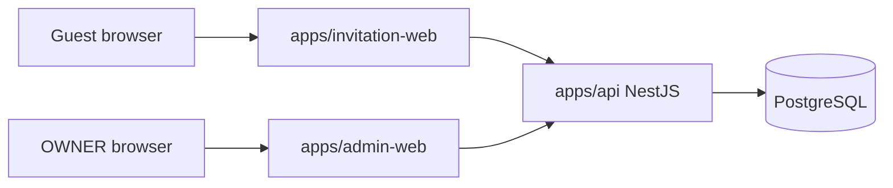

# Technical Architecture

## System Context



Frontends never access PostgreSQL directly. The backend API owns authentication, authorization, domain validation, persistence, credential derivation, QR/pass lifecycle, import, check-in, and reporting.

## Monorepo Layout

Planned layout:

```text
apps/
  invitation-web/
  admin-web/
  api/
packages/
  api-client/
  shared-types/
  eslint-config/
  tsconfig/
docs/
```

Do not create this structure until Phase 1 after final Phase 0 documentation lock.

## Application Responsibilities

### invitation-web

- Render the Figma-derived public invitation.
- Manage envelope/opened/long-page flow.
- Call public invitation APIs.
- Provide UX validation and loading/error states.
- Submit RSVP with `expectedVersion`.
- Display RSVP confirmation and backend-derived active QR payload.

### admin-web

- Provide OWNER login.
- Manage invitations, invitees, event eligibility, imports, RSVP, messages, check-in, and reports.
- Use generated API client.
- Never embed database logic.

### api

- Expose public and admin HTTP APIs.
- Enforce all business rules.
- Manage opaque admin sessions.
- Derive public invitation and check-in credentials without storing plaintext bearer values.
- Own OpenAPI contract generation.
- Use PostgreSQL through Prisma.

## Backend Modular Monolith

Expected modules:

- `auth`: OWNER login/logout, sessions, password verification, CSRF/origin checks.
- `admin-users`: OWNER account persistence and password lifecycle.
- `invitations`: invitation lifecycle, credential regeneration, public access, open aggregates.
- `invitees`: named invitee management.
- `events`: event definitions and ordering.
- `rsvp`: household RSVP, event selections, current attendee composition, dietary notes, versioning, pass lifecycle coordination.
- `messages`: guest messages.
- `checkin`: pass credential derivation, QR validation, duplicate-safe CheckinRecord confirmation.
- `imports`: CSV/XLSX parse, validate, preview, commit.
- `reports`: dashboard metrics and CSV export.
- `database`: Prisma integration and transaction helpers.
- `security`: HMAC credential derivation, hashing, session token generation, and redaction helpers.
- `health`: health/readiness endpoints.
- `common`: shared errors, pagination, request context.

Module dependency rule: feature modules may depend on `common`, `database`, and `security`; cross-feature writes should go through application services, not direct table manipulation from unrelated modules.

## API Contract and Client Generation

- OpenAPI generated by the NestJS backend is the API contract source.
- `packages/api-client` should be generated from OpenAPI.
- Frontends consume the generated client rather than duplicating TypeScript interfaces.
- Breaking API changes require updating `API-CONTRACT.md`, regenerating the client, and updating dependent frontend code in the same task.

## Public Resource Identifiers

PostgreSQL primary keys are UUIDs. For MVP, API DTOs may expose UUID identifiers for non-secret resources that the client must reference, such as events, invitees, invitations in admin APIs, RSVP records, and check-in records. These UUIDs are random, non-sequential identifiers. The API must never expose credential hashes, credential versions, password/session data, internal audit-only fields, or admin-only notes in public responses.

## Admin Authentication Architecture

MVP uses opaque server-managed sessions, not JWT access/refresh tokens.

Rationale:

- Personal/internal OWNER-only admin.
- Simpler revocation and expiry.
- Avoids unnecessary token refresh complexity.
- Compatible with Next.js admin frontend and NestJS API on Docker/VPS.

Flow:

1. OWNER submits email and password to `POST /admin/auth/login`.
2. API verifies password using Argon2id hash.
3. API generates a high-entropy random session token.
4. API stores only `session_token_hash` in `AdminSession`.
5. API sets an HttpOnly cookie, for example `admin_session`.
6. API returns or otherwise establishes an anti-CSRF token for unsafe admin requests.
7. Admin frontend sends `X-CSRF-Token` for unsafe methods.
8. API authenticates by hashing the cookie token and finding an active unexpired session.
9. Logout revokes the session and clears the cookie.

Final implementation must specify production same-site/origin topology, cookie attributes, CSRF issuance/recovery, allowed credentialed origins, logout cookie clearing, and expired-session cleanup before auth ships.

## Credential Architecture

Public invitation and check-in credentials are deterministic server-derived bearer credentials.

Conceptual derivation:

```text
credential = Base64URL(
  HMAC-SHA256(
    server credential secret,
    namespace + stable record id + credential version
  )
)
```

Use separate namespaces for at least:

- `invitation`.
- `checkin`.

Separate derived keys/secrets per namespace are preferred if straightforward during implementation.

### Server credential secret

- Comes from deployment environment/secret manager.
- Never committed.
- Never logged.
- Sufficiently random.
- Production secret differs from development/test.
- Changing it invalidates derivability of existing credentials unless a planned regeneration/migration process exists.
- MVP treats credential-secret rotation as an operational maintenance concern, not a multi-key rotation feature.

### Public invitation credential

- Derived from server secret, invitation namespace, `Invitation.id`, and `public_token_version`.
- Lookup uses stored `public_token_hash`.
- Admin regenerate link locks Invitation, increments `public_token_version`, derives new credential, stores new hash, and returns the new URL.
- Admin copy current URL can re-derive the current credential over protected OWNER API.
- Plaintext public credential is not persisted.
- Must not be logged.

### Check-in credential

- Derived from server secret, check-in namespace, `CheckinPass.id`, and `credential_version`.
- Lookup uses stored `token_hash`.
- Public API can re-derive the active pass credential for QR display.
- Revoked pass remains in history but validation rejects it.
- Revoked credentials must never become valid again.
- Plaintext QR payload/credential is not persisted.
- Must not be logged.

### Admin session credential

- High-entropy random session token in HttpOnly cookie.
- Stored as hash only.
- Revocable and expiring.
- Not exposed to JavaScript.
- Must not be logged.

## RSVP Authority and Lifecycle

Source-of-truth separation:

- `InvitationEvent`: which events the household is allowed to attend.
- `RSVPAttendee`: current household attendee composition for the RSVP overall.
- `RSVPEventSelection`: household intent and expected count for one event.
- `CheckinRecord`: actual confirmed household attendance for one event.

Per-event counts may differ. MVP does not track exactly which named attendee attends which event.

RSVP transitions:

- `PENDING -> ACCEPTED`: save valid RSVP, selections, attendees, create one active CheckinPass, increment version, commit atomically.
- `PENDING -> DECLINED`: save declined state, ensure no active pass, clear active attendance selections, increment version, commit atomically.
- `ACCEPTED -> ACCEPTED`: update current RSVP details and normally retain current active pass; do not issue another pass merely because details changed.
- `ACCEPTED -> DECLINED`: update RSVP to declined, revoke active pass, increment version, commit atomically.
- `DECLINED -> ACCEPTED`: update RSVP, issue new CheckinPass, increment version, commit atomically.
- `DECLINED -> DECLINED`: update permitted decline state, keep no active pass, increment version.

Public RSVP mutation requires `expectedVersion`. Mismatch returns `409 RSVP_VERSION_CONFLICT`; do not use last-write-wins.

## Shared Transaction Lock Order

Every state-changing operation that can conflict for one invitation must:

1. Begin transaction.
2. `SELECT` the target Invitation row `FOR UPDATE`.
3. Reload and revalidate dependent current state.
4. Apply the domain transition.
5. Commit.

Use this rule for public RSVP mutation, OWNER RSVP override, event eligibility changes that can affect RSVP/check-in, check-in confirmation, invitation archive where relevant, and pass or invitation credential regeneration/rotation where relevant. Do not introduce Redis or distributed locks for MVP.

## Check-in Architecture

QR validation flow:

1. Staff scans QR.
2. Scanner decodes supported payload.
3. Admin frontend sends credential payload and selected event to backend validation endpoint.
4. Backend resolves credential hash and validates active pass, active invitation, accepted RSVP, event eligibility, selected event attendance, expected count, and whether `CheckinRecord` already exists.
5. Backend returns preview/status.

Validation is read-only. It is not a reservation and does not create `CheckinRecord`.

Confirmation flow for QR and manual check-in:

1. Begin transaction.
2. Lock Invitation row `FOR UPDATE`.
3. Load current RSVP/event/pass state.
4. Revalidate eligibility, accepted RSVP, selected event, and active pass when QR is used.
5. Check existing `CheckinRecord` for Invitation + Event.
6. Validate `attendee_count >= 1` and `attendee_count <= RSVPEventSelection.expected_attendee_count`.
7. Insert `CheckinRecord`.
8. Commit.

Manual and QR confirmation use the same domain service after invitation resolution. The unique `Invitation + Event` database constraint is the final duplicate guard.

Invalid, revoked, rejected, or duplicate attempts are API responses and operational logs only in MVP. They are not `CheckinRecord` rows.

## Archive Policy

When Invitation is `ARCHIVED`:

- Public invitation access is denied.
- Public RSVP read/write is denied.
- Guest message submission is denied.
- QR validation/check-in is denied.
- Public response is generic `404 INVITATION_NOT_AVAILABLE`.
- OWNER admin APIs may still view invitation, invitees, RSVP, messages, pass history, and check-in records.
- Active dashboard metrics exclude archived invitations by default and show archived count separately.
- Reports may include archived invitations through explicit filters.

## Import Architecture

Flow:

Upload -> Parse -> Validate -> Detect possible duplicate -> Preview -> Admin decision -> Commit.

Preview is not a committed `GuestImportBatch`. Preview lifetime and idempotent commit semantics are a Phase 9 gate.

MVP commit is all-or-nothing for selected valid rows in one transaction. The transaction creates invitations, invitees, invitation events, default RSVP state where used, invitation credential version/hash initialization, and successful `GuestImportBatch` provenance. Failed-attempt persistence, if later desired, must occur outside the rolled-back domain transaction.

Validation must distinguish:

- Error: prevents commit until fixed or row excluded.
- Warning: admin can decide whether to proceed.

Potential duplicates are warnings unless a real uniqueness rule is violated.

## Reporting Architecture

Reports derive from persisted invitation aggregate open fields, RSVP, RSVP attendee, event selection, messages, pass history, and CheckinRecord data. MVP export is CSV only.

No separate analytics datastore is required for MVP.

## Error Handling

Use a consistent JSON error envelope:

```json
{
  "error": {
    "code": "EVENT_NOT_ALLOWED",
    "message": "This invitation is not eligible for the selected event.",
    "details": {}
  }
}
```

Public errors should avoid leaking existence or internal security details. Admin errors may include actionable validation detail. Do not expose stack traces or internal exception messages.

## Observability and Logging

- Use Pino structured logging.
- Include request ID, route, status, latency, and authenticated admin ID where applicable.
- Redact credentials, credential hashes, credential versions where sensitive, cookies, passwords, password hashes, and QR payloads.
- Log important admin operations without storing secrets.
- Invalid/revoked QR attempts may be operational logs only, with credential redaction.

## Deployment and CI Direction

- Docker-based apps.
- PostgreSQL as the primary database.
- GitHub Actions for lint, typecheck, tests, build, and deployment packaging.
- VPS/self-host/Coolify-style deployment compatible.
- No Kubernetes or managed cloud dependency required for MVP.

## Scaling Considerations

The modular monolith and PostgreSQL are sufficient for MVP. Add Redis, queues, external object storage, search, or analytics stores only after a demonstrated requirement emerges.
