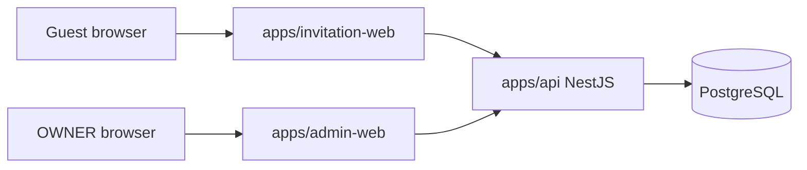

# Technical Architecture

## System Context



Frontends never access PostgreSQL directly. The backend API owns authentication, authorization, domain validation, persistence, credential derivation, QR/pass lifecycle, import, check-in, and reporting.

## Monorepo Layout

Planned layout:

```text
apps/
  invitation-web/
  admin-web/
  api/
packages/
  api-client/
  shared-types/
  eslint-config/
  tsconfig/
docs/
```

Do not create this structure until Phase 1 after final Phase 0 documentation lock.

## Application Responsibilities

### invitation-web

- Render the Figma-derived public invitation.
- Manage envelope/opened/long-page flow.
- Call public invitation APIs.
- Provide UX validation and loading/error states.
- Submit RSVP with `expectedVersion`.
- Display RSVP confirmation and backend-derived active QR payload.

Phase 4 read-only frontend contract:

- Public route: `/i/[publicCredential]`.
- The route credential is case-sensitive and must not be normalized, stored in
  browser storage, sent to analytics, copied into visible error UI, or logged by
  custom frontend code.
- Retrieval is server-side by default: the route receives the credential, uses
  the generated `packages/api-client`, calls
  `GET /api/public/invitations/{publicCredential}`, and passes the
  `PublicInvitationResponse` to presentation components.
- Use the server-only environment variable `INVITATION_API_BASE_URL` for the API
  origin/base URL. It must not be prefixed with `NEXT_PUBLIC_` and must not
  contain credentials. Local development value is conceptually
  `http://localhost:4000`.
- Client components are limited to local visual state such as envelope/opened
  transitions, reveal behavior, and reduced-motion handling. Avoid duplicate
  client-side invitation fetching and do not introduce TanStack Query for Phase 4
  unless a later technical review documents a need.
- Public invitation event timestamps remain backend-owned ISO date-time values.
  `invitation-web` owns guest-facing venue-local presentation for event cards:
  render `startsAt` in `Asia/Jakarta` using `HH.mm` 24-hour format without
  relying on process, server, browser, or workstation local timezone settings.
- Phase 4 maps `INVITATION_NOT_AVAILABLE` to one generic unavailable UI and does
  not infer whether a credential was malformed, unknown, stale, or archived.
- Phase 4 does not implement RSVP submission, QR confirmation, or guest message
  submission.

### admin-web

- Provide OWNER login.
- Manage invitations, invitees, event eligibility, imports, RSVP, messages, check-in, and reports.
- Use generated API client.
- Never embed database logic.

### api

- Expose public and admin HTTP APIs.
- Enforce all business rules.
- Manage opaque admin sessions.
- Derive public invitation and check-in credentials without storing plaintext bearer values.
- Own OpenAPI contract generation.
- Use PostgreSQL through Prisma.

## Backend Modular Monolith

Expected modules:

- `auth`: OWNER login/logout, sessions, password verification, CSRF/origin checks.
- `admin-users`: OWNER account persistence and password lifecycle.
- `invitations`: invitation lifecycle, credential regeneration, public access, open aggregates.
- `invitees`: named invitee management.
- `events`: event definitions and ordering.
- `rsvp`: household RSVP, event selections, current attendee composition, dietary notes, versioning, pass lifecycle coordination.
- `messages`: public guest message submission and persistence (Phase 7). Owns the create-only public endpoint and plain-text content validation. Does not own admin listing, moderation, or message read operations.
- `checkin`: pass credential derivation, QR validation, duplicate-safe CheckinRecord confirmation.
- `imports`: CSV/XLSX parse, validate, preview, commit.
- `reports`: dashboard metrics and CSV export.
- `database`: Prisma integration and transaction helpers.
- `security`: HMAC credential derivation, hashing, session token generation, and redaction helpers.
- `health`: health/readiness endpoints.
- `common`: shared errors, pagination, request context.

Module dependency rule: feature modules may depend on `common`, `database`, and `security`; cross-feature writes should go through application services, not direct table manipulation from unrelated modules.

## API Contract and Client Generation

- OpenAPI generated by the NestJS backend is the API contract source.
- `packages/api-client` should be generated from OpenAPI.
- Frontends consume the generated client rather than duplicating TypeScript interfaces.
- Breaking API changes require updating `API-CONTRACT.md`, regenerating the client, and updating dependent frontend code in the same task.

## Public Resource Identifiers

PostgreSQL primary keys are UUIDs. For MVP, API DTOs may expose UUID identifiers for non-secret resources that the client must reference, such as events, invitees, invitations in admin APIs, RSVP records, and check-in records. These UUIDs are random, non-sequential identifiers. The API must never expose credential hashes, credential versions, password/session data, internal audit-only fields, or admin-only notes in public responses.

## Admin Authentication Architecture

MVP uses opaque server-managed sessions, not JWT access/refresh tokens.

Rationale:

- Personal/internal OWNER-only admin.
- Simpler revocation and expiry.
- Avoids unnecessary token refresh complexity.
- Compatible with Next.js admin frontend and NestJS API on Docker/VPS.

Flow:

1. OWNER submits email and password to `POST /admin/auth/login`.
2. API verifies password using Argon2id hash.
3. API generates a high-entropy random session token.
4. API stores only `session_token_hash` in `AdminSession`.
5. API sets an HttpOnly cookie, for example `admin_session`.
6. API returns or otherwise establishes an anti-CSRF token for unsafe admin requests.
7. Admin frontend sends `X-CSRF-Token` for unsafe methods.
8. API authenticates by hashing the cookie token and finding an active unexpired session.
9. Logout revokes the session and clears the cookie.

Final implementation must specify production same-site/origin topology, cookie attributes, CSRF issuance/recovery, allowed credentialed origins, logout cookie clearing, and expired-session cleanup before auth ships.

## Credential Architecture

Public invitation and check-in credentials are deterministic server-derived bearer credentials.

The Phase 3 public invitation credential format is a stable compatibility contract. Changing the canonical input format, output encoding, or lookup hash after credentials have been issued requires an explicit compatibility or migration decision.

### Credential namespaces

Use separate namespaces for at least:

- `invitation`.
- `check-in`.

The invitation namespace is exactly `invitation`. The check-in namespace is exactly `check-in`.

### Public invitation derivation contract

Public invitation credentials use:

- Stable record id: `Invitation.id`.
- UUID canonical form: lowercase standard 8-4-4-4-12 representation, for example `01234567-89ab-4def-8123-456789abcdef`.
- Credential version: `Invitation.public_token_version`.
- Version canonical form: positive decimal integer with no leading zeroes.

The canonical HMAC input is the following component sequence encoded as UTF-8 bytes:

```text
v1<NUL>invitation<NUL><canonical-uuid><NUL><version>
```

Where:

- `v1` is literal ASCII and is part of the permanent derivation contract.
- `invitation` is literal ASCII.
- `<NUL>` means one zero byte, `0x00`; it does not mean the two characters `\` and `0`.
- UUID is lowercase canonical form.
- Version is canonical decimal integer.

Use HMAC-SHA-256 from Node built-in `crypto`. The raw HMAC result is 32 bytes. Encode the raw result as RFC 4648 Base64URL without padding. The public credential is exactly 43 ASCII characters, matches `[A-Za-z0-9_-]{43}`, is case-sensitive, has no `=` padding, and is safe in a URL path without percent encoding.

### Lookup hash contract

Persist only a lookup hash for public credentials:

```text
public_token_hash = lowercaseHex(SHA-256(UTF8(publicCredential)))
```

`publicCredential` is exactly the 43-character Base64URL credential string. The lookup hash is 64 lowercase hexadecimal characters and is stored in `Invitation.public_token_hash`. The existing PostgreSQL `text` column is sufficient. Plaintext public credentials must never be persisted.

Inbound public credential processing:

1. Receive the route path credential.
2. Validate exactly `[A-Za-z0-9_-]{43}`.
3. Malformed values collapse to the generic unavailable behavior.
4. Calculate `SHA-256(UTF8(publicCredential))`.
5. Encode lowercase hex.
6. Query `Invitation.public_token_hash`.
7. Lock the matched Invitation row according to the public retrieval transaction contract.
8. Require `Invitation.status = ACTIVE`.
9. Project only the approved public fields.

Do not try to derive an inbound credential; the caller does not provide the Invitation id or credential version. Do not retrieve candidate rows and compare credentials in application memory. Constant-time application comparison is not required for this indexed equality lookup.

When credential regeneration is implemented later, `public_token_version` increments, a new deterministic credential is derived, and `public_token_hash` is replaced. Old credentials stop resolving naturally. Malformed, unknown, stale, archived, and otherwise unavailable credentials must remain publicly indistinguishable.

### Server credential secret

- Comes from `CREDENTIAL_SECRET`.
- Canonical environment representation is unpadded Base64URL.
- The decoded value must be exactly 32 bytes.
- Missing, padded, malformed Base64URL, or incorrectly sized values fail application startup.
- No fallback, hard-coded, or committed secret is allowed.
- The source value and decoded bytes must never be logged.
- Production secret differs from development/test.
- Changing it invalidates derivability of existing credentials unless a planned regeneration/migration process exists.
- MVP treats credential-secret rotation as an operational maintenance concern, not a multi-key rotation feature.
- Tests may inject deterministic test secret material. CI/integration environments may provide an explicitly non-production deterministic test secret.
- No key ring, key identifier, multi-secret rotation framework, or namespace-specific subkey derivation is required in Phase 3; namespace separation in the canonical input is sufficient for the current application.

### Public invitation credential

- Derived from `CREDENTIAL_SECRET`, invitation namespace, `Invitation.id`, and `public_token_version` using the contract above.
- Lookup uses stored `public_token_hash`.
- Admin regenerate link locks Invitation, increments `public_token_version`, derives new credential, stores new hash, and returns the new URL.
- Admin copy current URL can re-derive the current credential over protected OWNER API.
- Plaintext public credential is not persisted.
- Must not be logged.

### Compatibility vector

The following public test vector freezes the Phase 3 credential contract. It is not a production secret.

- Secret Base64URL: `AAECAwQFBgcICQoLDA0ODxAREhMUFRYXGBkaGxwdHh8`
- Decoded secret: bytes `0x00` through `0x1f`
- Namespace: `invitation`
- Stable UUID: `01234567-89ab-4def-8123-456789abcdef`
- Version: `1`
- Canonical input hex: `763100696e7669746174696f6e0030313233343536372d383961622d346465662d383132332d3435363738396162636465660031`
- Expected credential: `GqcxcwGaB27NYCErZeJhqWufpfVeSA-jFQkfG-qYBRE`
- Expected lookup hash: `725ce76a6b049c6dffaf1624b045fb34961ac04039921692c24e16dee757aebd`

Compatibility and security tests must freeze the exact vector, 43-character Base64URL output, uppercase UUID canonicalization, namespace/id/version/secret changes altering output, malformed UUID rejection, invalid version rejection, invalid namespace rejection, malformed or missing secret startup failure, stale credential rejection, archive privacy, and absence of raw credentials or hashes from logs and errors.

### Check-in credential

- Derived from server secret, check-in namespace, `CheckinPass.id`, and `credential_version`.
- Lookup uses stored `token_hash`.
- Public API can re-derive the active pass credential for QR display.
- Revoked pass remains in history but validation rejects it.
- Revoked credentials must never become valid again.
- Plaintext QR payload/credential is not persisted.
- Must not be logged.

Redisplay doctrine (Phase 6 lock):

- Guest pass redisplay does **not** require storing a plaintext credential, and no schema or storage change is required for it.
- The server re-derives the credential on demand from `CheckinPass.id`, `CheckinPass.credentialVersion`, and the server credential secret, using the existing `check-in` namespace and the existing derivation algorithm.
- The derivation algorithm, the namespace strings, and `credentialVersion` behavior are unchanged by Phase 6.
- The re-derived value is the exact string published as `qrPayload`: an unpadded Base64URL opaque credential. The QR image encodes that credential string and nothing else.
- Re-derivation is only performed for a pass that is currently `ACTIVE`. A revoked pass row may exist in history, but its credential is never re-derived and never returned publicly.
- Where a re-derived credential is used for verification, the implementation compares it against the currently persisted `token_hash` for the pass rather than trusting the derivation alone.
- Exposing the credential on a public response does not weaken the invitation credential: the invitation credential and the check-in credential use separate namespaces and are never interchangeable.

### Admin session credential

- High-entropy random session token in HttpOnly cookie.
- Stored as hash only.
- Revocable and expiring.
- Not exposed to JavaScript.
- Must not be logged.

## RSVP Authority and Lifecycle

Source-of-truth separation:

- `InvitationEvent`: which events the household is allowed to attend.
- `RSVPAttendee`: current household attendee composition for the RSVP overall.
- `RSVPEventSelection`: household intent and expected count for one event.
- `CheckinRecord`: actual confirmed household attendance for one event.

Per-event counts may differ. MVP does not track exactly which named attendee attends which event.

RSVP transitions:

- `(no RSVP row) -> ACCEPTED` / `(no RSVP row) -> DECLINED`: first public mutation with `expectedVersion: null`; creates the RSVP row at `version = 1`.
- `PENDING -> ACCEPTED`: save valid RSVP, selections, attendees, create one active CheckinPass, increment version, commit atomically.
- `PENDING -> DECLINED`: save declined state, ensure no active pass, clear active attendance selections, increment version, commit atomically.
- `ACCEPTED -> ACCEPTED`: update current RSVP details and retain the existing active pass; do not issue another pass merely because details changed and do not create a duplicate active pass.
- `ACCEPTED -> DECLINED`: update RSVP to declined, revoke active pass, increment version, commit atomically.
- `DECLINED -> ACCEPTED`: update RSVP, issue a new CheckinPass, increment version, commit atomically. Never reactivate the previously revoked credential.
- `DECLINED -> DECLINED`: update permitted decline state, keep no active pass, increment version.

Transition to `DECLINED` leaves clean state in the same transaction: `status = DECLINED`, `dietary_notes = null`, no attending event selections, no RSVPAttendee rows, and no `ACTIVE` CheckinPass. Revoked pass rows may remain as historical/audit facts.

Public RSVP mutation requires `expectedVersion`. Mismatch returns `409 RSVP_VERSION_CONFLICT`; do not use last-write-wins.

Phase 5 contract lock:

- `expectedVersion` is `integer | null`. `null` means create-only and fails with `409 RSVP_VERSION_CONFLICT` when an RSVP row already exists at lock time. An integer must equal the persisted `RSVP.version`.
- Do not eagerly create empty/`PENDING` RSVP rows to manufacture a version. Initial persisted `version = 1`; each successful mutation increments it.
- `ACCEPTED` requires at least one eligible attending event (`InvitationEvent` is the authoritative eligibility relation). Accepted with zero attending events returns `422 EVENT_NOT_SELECTED`.
- `dietaryNotes` is household-level: trimmed, maximum 500 characters after trimming, empty after trimming normalizes to `null`.
- `guestNote` is outside the Phase 5 public RSVP contract. It is not accepted, mutated, or cleared by RSVP accept/decline, and it stays separate from Guest Message work.
- Public RSVP create and update are both allowed up to and including the cutoff instant and both rejected afterwards with `422 RSVP_DEADLINE_PASSED`. The cutoff instant is `Invitation.rsvp_deadline_at`; the Phase 5 public baseline is `2026-12-25T16:59:59Z`. Public invitation GET remains available after the cutoff. Phase 5 defines no public post-deadline override.
- The RSVP mutation and the CheckinPass lifecycle happen in the same Invitation-scoped transaction.

## Guest Messages

Guest message persistence is the existing `GuestMessage` model: `invitation_id`, nullable `author_name`, `message`, `created_at`, and the internal `is_hidden` moderation flag. No RSVP relation, no Invitee relation, no unique constraint, and no version column exist or are added. One `Invitation` owns many `GuestMessage` rows.

Phase 7 contract lock (Slice 7B0):

- The public guest-message API is **create-only**: `POST /api/public/invitations/{publicCredential}/messages`. There is no public read, update, or delete operation, and no public message wall.
- Public response is `201 Created` with `{ "message": { "createdAt": "<ISO-8601>" } }` only. `GuestMessage.id` and all internal ownership and moderation fields stay private.
- The request carries `message` (required) and `authorName` (optional) and nothing else. It never accepts `invitationId`, `inviteeId`, `rsvpId`, `isHidden`, `createdAt`, or `id`.
- `message` is plain text, trimmed, non-empty after trimming, and at most 1000 Unicode characters after trimming. `authorName` is plain text, trimmed, `null` when empty after trimming, and at most 100 Unicode characters after trimming. HTML and Markdown are never interpreted, and message bodies are never rendered with `dangerouslySetInnerHTML`.
- Submission depends only on `Invitation.status === ACTIVE`. It is independent of RSVP existence, RSVP status, and `Invitation.rsvp_deadline_at`.
- Messages are append-only. Each explicit successful submission creates a new row. There is no idempotency key, no unique message-per-invitation rule, no optimistic version, and no update-on-duplicate behavior; an explicit resubmission after an uncertain network outcome may duplicate, and that is accepted for the MVP.
- No new error codes are introduced. Invalid content uses the shared `400 VALIDATION_ERROR` envelope; unavailable or archived invitations use the existing generic `404 INVITATION_NOT_AVAILABLE` without revealing which case occurred.
- `GuestMessage` is **not** `RSVP.guestNote`. Phase 7 never writes, clears, mirrors, or synchronizes `RSVP.guestNote`; the two remain separate concepts.

Guest message resolution doctrine (semantic requirement, not an implementation mandate):

1. Validate the public credential shape.
2. Derive and hash the credential through the existing public-invitation mechanism.
3. Enter an appropriate database transaction.
4. Resolve the owning Invitation through the public credential.
5. Require `status === ACTIVE`.
6. Create one `GuestMessage` using the resolved `Invitation.id`.
7. Commit.
8. Return only `{ message: { createdAt } }`.

The owning Invitation id comes **exclusively** from credential resolution and is never taken from the request body. The ACTIVE-invitation check must hold atomically with the write so a message is never intentionally inserted into an archived invitation. The implementation may extract or reuse the existing active-invitation resolution logic rather than coupling the messages module to RSVP-specific service code, but no broad refactor is required. Guest message semantics need no RSVP row lock and no `expectedVersion`.

Admin message visibility and moderation are deferred to Phase 8+. `is_hidden` remains an internal moderation property: Phase 7 submission does not accept it, does not return it, and creates rows in the normal default internal state. Because there is no public message wall, "visible" does not mean publicly listed.

## Shared Transaction Lock Order

Every state-changing operation that can conflict for one invitation must:

1. Begin transaction.
2. `SELECT` the target Invitation row `FOR UPDATE`.
3. Reload and revalidate dependent current state.
4. Apply the domain transition.
5. Commit.

Use this rule for public RSVP mutation, OWNER RSVP override, event eligibility changes that can affect RSVP/check-in, check-in confirmation, invitation archive where relevant, and pass or invitation credential regeneration/rotation where relevant. Do not introduce Redis or distributed locks for MVP.

### Public invitation retrieval and open tracking

Valid public invitation retrieval is not a pure read. It mutates `first_opened_at`, `last_opened_at`, and `open_count`, so it follows the Invitation-first lock discipline.

Exact sequence:

1. Validate and hash the inbound public credential outside the database transaction.
2. Start a Prisma interactive transaction.
3. Lock the matching Invitation row using a narrow parameterized query equivalent to:

   ```sql
   SELECT id, status
   FROM invitations
   WHERE public_token_hash = $1
   FOR UPDATE;
   ```

4. If no row exists, return generic `INVITATION_NOT_AVAILABLE`.
5. If current status is not `ACTIVE`, return the same generic unavailable result.
6. Perform one atomic parameterized update equivalent to:

   ```sql
   UPDATE invitations
   SET
     first_opened_at = COALESCE(first_opened_at, CURRENT_TIMESTAMP),
     last_opened_at = CURRENT_TIMESTAMP,
     open_count = open_count + 1,
     updated_at = CURRENT_TIMESTAMP
   WHERE id = $1::uuid
     AND status = 'ACTIVE'
   RETURNING
     first_opened_at,
     last_opened_at,
     open_count;
   ```

7. Exactly one row must be updated.
8. Within the same transaction, read the approved public projection: Invitation public fields, InvitationEvent/Event rows, Invitees, and optional RSVP.
9. Commit.
10. Map the already-read data to the public DTO.

Properties:

- `open_count` increments atomically.
- Concurrent valid loads cannot lose increments.
- `first_opened_at` is assigned once via `COALESCE`.
- `last_opened_at` changes on every valid load.
- The first valid load produces `open_count = 1`, `first_opened_at = current transaction timestamp`, and `last_opened_at = current transaction timestamp`.
- All projection reads belong inside the same transaction.
- PostgreSQL `READ COMMITTED` is sufficient when all conflicting invitation-scoped writers follow Invitation-first locking.
- No `InvitationOpen` table, IP tracking, or user-agent tracking is required.

Archive/open race behavior is linearized by the Invitation lock:

- If public retrieval acquires the Invitation lock first, it validates `ACTIVE`, records one valid open, reads and returns the active projection, and archive waits.
- If archive commits first, later public retrieval sees `ARCHIVED`, records no open, and returns `INVITATION_NOT_AVAILABLE`.

Open tracking is persisted domain/reporting data, not best-effort telemetry. If the aggregate update or public projection read fails, the transaction rolls back and the request fails; do not return a successful invitation response after a failed open-tracking transaction.

## Check-in Architecture

QR validation flow:

1. Staff scans QR.
2. Scanner decodes supported payload.
3. Admin frontend sends credential payload and selected event to backend validation endpoint.
4. Backend resolves credential hash and validates active pass, active invitation, accepted RSVP, event eligibility, selected event attendance, expected count, and whether `CheckinRecord` already exists.
5. Backend returns preview/status.

Validation is read-only. It is not a reservation and does not create `CheckinRecord`.

Confirmation flow for QR and manual check-in:

1. Begin transaction.
2. Lock Invitation row `FOR UPDATE`.
3. Load current RSVP/event/pass state.
4. Revalidate eligibility, accepted RSVP, selected event, and active pass when QR is used.
5. Check existing `CheckinRecord` for Invitation + Event.
6. Validate `attendee_count >= 1` and `attendee_count <= RSVPEventSelection.expected_attendee_count`.
7. Insert `CheckinRecord`.
8. Commit.

Manual and QR confirmation use the same domain service after invitation resolution. The unique `Invitation + Event` database constraint is the final duplicate guard.

Invalid, revoked, rejected, or duplicate attempts are API responses and operational logs only in MVP. They are not `CheckinRecord` rows.

## Archive Policy

When Invitation is `ARCHIVED`:

- Public invitation access is denied.
- Public RSVP read/write is denied.
- Guest message submission is denied.
- QR validation/check-in is denied.
- Public response is generic `404 INVITATION_NOT_AVAILABLE`.
- OWNER admin APIs may still view invitation, invitees, RSVP, messages, pass history, and check-in records.
- Active dashboard metrics exclude archived invitations by default and show archived count separately.
- Reports may include archived invitations through explicit filters.

## Import Architecture

Flow:

Upload -> Parse -> Validate -> Detect possible duplicate -> Preview -> Admin decision -> Commit.

Preview is not a committed `GuestImportBatch`. Preview lifetime and idempotent commit semantics are a Phase 9 gate.

MVP commit is all-or-nothing for selected valid rows in one transaction. The transaction creates invitations, invitees, invitation events, default RSVP state where used, invitation credential version/hash initialization, and successful `GuestImportBatch` provenance. Failed-attempt persistence, if later desired, must occur outside the rolled-back domain transaction.

Validation must distinguish:

- Error: prevents commit until fixed or row excluded.
- Warning: admin can decide whether to proceed.

Potential duplicates are warnings unless a real uniqueness rule is violated.

## Reporting Architecture

Reports derive from persisted invitation aggregate open fields, RSVP, RSVP attendee, event selection, messages, pass history, and CheckinRecord data. MVP export is CSV only.

No separate analytics datastore is required for MVP.

## Error Handling

Use a consistent JSON error envelope:

```json
{
  "error": {
    "code": "EVENT_NOT_ALLOWED",
    "message": "This invitation is not eligible for the selected event.",
    "details": {}
  }
}
```

Public errors should avoid leaking existence or internal security details. Admin errors may include actionable validation detail. Do not expose stack traces or internal exception messages.

## Observability and Logging

- Use Pino structured logging.
- Include request ID, route, status, latency, and authenticated admin ID where applicable.
- Redact credentials, credential hashes, credential versions where sensitive, cookies, passwords, password hashes, and QR payloads.
- Log important admin operations without storing secrets.
- Invalid/revoked QR attempts may be operational logs only, with credential redaction.

## Deployment and CI Direction

- Docker-based apps.
- PostgreSQL as the primary database.
- GitHub Actions for lint, typecheck, tests, build, and deployment packaging.
- VPS/self-host/Coolify-style deployment compatible.
- No Kubernetes or managed cloud dependency required for MVP.

## Scaling Considerations

The modular monolith and PostgreSQL are sufficient for MVP. Add Redis, queues, external object storage, search, or analytics stores only after a demonstrated requirement emerges.
